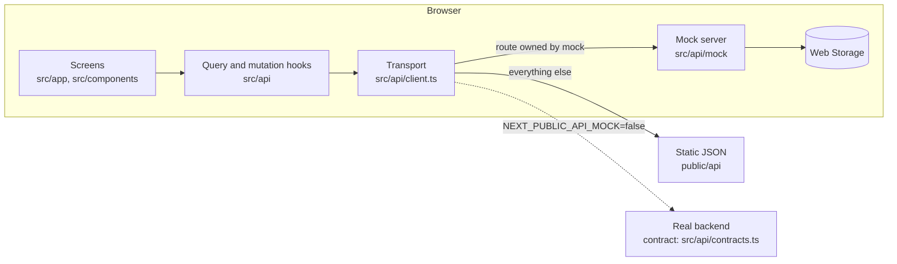

# The Olive Table: developer documentation

Technical documentation for the Olive Table web app: a QR-code ordering app for guests, a staff app
for waiters and the kitchen, and the Settings that configure each branch. Start here, then follow
the reading path for your role.

## What the system is

- **Guests** scan the QR code on their table (or choose an outlet for takeaway or delivery),
  browse the branch's menu, check out with their mobile number and an OTP, pay online or in
  person, follow their order, call a waiter and pay their own bill.
- **Staff** sign in, pick a branch and run service: tables, orders, requests, menu availability,
  reservations, payments and QR codes. The **kitchen** works from its own ticket board.
- **Settings** configure each branch: details and region, opening hours, taxes, payment methods,
  services, delivery zones, pickup, the floor plan, and the branches themselves.

The app is a **static Next.js export** with no server of its own. Every read and write goes through
a typed API layer. Until the backend exists, an **in-browser mock server** answers exactly as the
backend contract specifies, so connecting the real API is a configuration change.



## Reading path

New to the project? Read in this order:

1. [Architecture](architecture.md): stack, folder structure, how a request becomes a screen.
2. [Conventions](conventions.md): coding standards, styling, copy, accessibility, definition of
   done.
3. The area you will work on: [Guest app](guest-app.md), [Staff app](staff-app.md) or
   [Settings](settings.md).
4. [Data and API](data-and-api.md): queries, mutations, the mock server, screen copy.
5. [How-to recipes](how-to.md) when you add a page, a setting or an endpoint.

Backend developers: [API contract](api-contract.md), then [Data and API](data-and-api.md) and
[Masters and configuration](masters-and-config.md).

## Documents

| Document                                       | Covers                                                         |
| ---------------------------------------------- | -------------------------------------------------------------- |
| [architecture.md](architecture.md)             | Stack, layers, folders, routes, state, responsive strategy     |
| [conventions.md](conventions.md)               | Code style, CSS, copy rules, accessibility, definition of done |
| [testing.md](testing.md)                       | Unit, mock-server and end-to-end tests; commands               |
| [guest-app.md](guest-app.md)                   | Guest journey, sessions, modes, pricing, checkout, tracking    |
| [staff-app.md](staff-app.md)                   | Sign-in, admin shell and pages, kitchen workspace              |
| [settings.md](settings.md)                     | Every Settings page and its rules                              |
| [data-and-api.md](data-and-api.md)             | Endpoints, hooks, mock server, content, real backend           |
| [api-contract.md](api-contract.md)             | Every endpoint: request, response, errors, rules               |
| [masters-and-config.md](masters-and-config.md) | Master values, region presets, app constants                   |
| [how-to.md](how-to.md)                         | Step-by-step recipes for common changes                        |
| [roadmap.md](roadmap.md)                       | Status, next work, production checklist, known issues          |

## Quick start

```bash
npm install
npm run dev          # http://localhost:3000
```

Staff pages: open `/admin/login/` and choose **Use demo account**. More commands are in the root
[README](../README.md#scripts) and in [testing.md](testing.md).

## Design source

The screens follow the design in `../the-olive-table-ui` (`screens/*.html`, `png/*.png`): the
mobile layout below 1024px, the web layout from 1024px. Staff pages, the kitchen and Settings
were not in that design; they follow the same design system.
