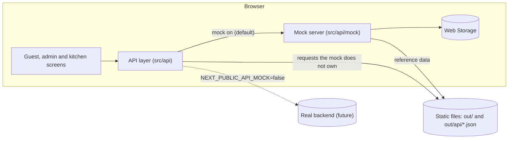
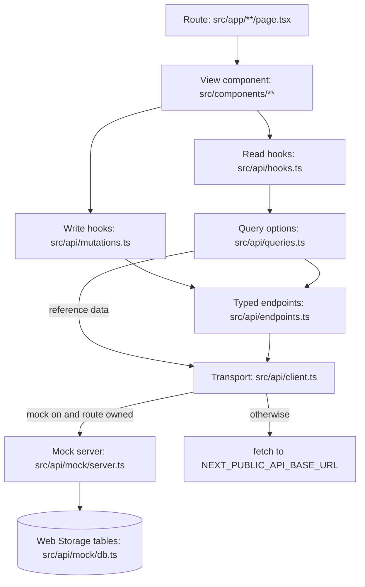
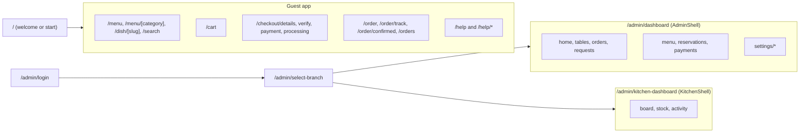

# Architecture

This page describes how The Olive Table web app is put together: the stack, the folder layout, the
layering rules, how data travels from an endpoint to a screen, where state lives and how one
codebase serves both the mobile and the desktop layout. Read it before your first change.

## Contents

- [System at a glance](#system-at-a-glance)
- [Tech stack](#tech-stack)
- [Folder structure](#folder-structure)
- [Rules of thumb](#rules-of-thumb)
- [How a request becomes a screen](#how-a-request-becomes-a-screen)
- [Build-time prefetch and hydration](#build-time-prefetch-and-hydration)
- [State management](#state-management)
- [Responsive strategy](#responsive-strategy)
- [Routes](#routes)
- [Related](#related)

## System at a glance

The Olive Table is a QR-code ordering site for a restaurant brand with branches in India and Nepal.
It has four areas, all in one Next.js project:

- **Guest app** (`/`, `/menu`, `/cart`, `/checkout/*`, `/order*`, `/help*`): a guest scans the
  table's QR code, orders, pays and follows the order on their phone.
- **Staff admin** (`/admin/login`, `/admin/select-branch`, `/admin/dashboard/*`): the waiter home,
  floor plan, orders, requests, menu, reservations and payments.
- **Kitchen workspace** (`/admin/kitchen-dashboard/*`): the kitchen board, stock and activity.
- **Settings** (`/admin/dashboard/settings/*`): branch details, hours, tax, payments, services,
  pickup, delivery, floor plan and branches.

There is no backend yet. The site is exported as static files, and every piece of data goes through
an API layer that is answered either by dummy JSON files or by an in-browser mock server that
implements the backend contract.



## Tech stack

| Concern         | Choice                                                             |
| --------------- | ------------------------------------------------------------------ |
| Framework       | Next.js 16 (App Router), React 19                                  |
| Language        | TypeScript (`tsc` is the native TypeScript 7 compiler)             |
| Server data     | TanStack Query 5                                                   |
| Forms           | react-hook-form with zod (`@hookform/resolvers`)                   |
| Styling         | CSS Modules and design tokens; no UI framework, no Tailwind        |
| QR codes        | `qrcode`                                                           |
| Unit tests      | Vitest, jsdom, React Testing Library                               |
| End-to-end      | Playwright against the static export                               |
| Lint and format | ESLint (`eslint-config-next`), Prettier                            |
| Runtime         | Node.js 20.9 or later for tooling; no Node.js server in production |

Why a static export with no server:

- [`next.config.ts`](../next.config.ts) sets `output: 'export'` and `trailingSlash: true`. Every
  route is prerendered at build time to `out/`, which any static host can serve (`npm start` serves
  it with `serve`).
- The backend does not exist yet. Rather than block on it, the app talks to a typed contract
  ([`src/api/contracts.ts`](../src/api/contracts.ts)). An in-browser mock server answers that
  contract today; switching to the real backend is a build-time environment change, not a code
  change.
- Because there is no request-time server, nothing can depend on per-request rendering. Dynamic
  data (orders, sessions, live branch status) is read in the browser after hydration.

The API is configured with `NEXT_PUBLIC_*` variables read at build time
([`src/api/config.ts`](../src/api/config.ts)):

| Variable                          | Default   | Purpose                                      |
| --------------------------------- | --------- | -------------------------------------------- |
| `NEXT_PUBLIC_API_BASE_URL`        | `/api`    | Base URL of the API                          |
| `NEXT_PUBLIC_API_SUFFIX`          | `.json`   | Appended to every path; empty for a real API |
| `NEXT_PUBLIC_API_MOCK`            | on        | `false` sends every request over HTTP        |
| `NEXT_PUBLIC_API_MOCK_LATENCY_MS` | `200-400` | Mock response time: a range or one number    |

See [data-and-api.md](data-and-api.md) for the endpoints and [api-contract.md](api-contract.md)
for the backend contract.

## Folder structure

```text
src/
  app/          Routes only: thin pages and layouts that set metadata and render one view.
  components/
    ui/         Design-system primitives (Button, Chip, Dialog, Icon...). No business logic.
    layout/     SiteHeader, MobileHeader, BottomNav, CartBar, CheckoutSteps, page shells.
    home/ start/ menu/ cart/ checkout/ order/ service/ status/
                Guest screens, one folder per area.
    admin/      Staff pages: sign-in, branch picker, shell/ (AdminShell, Sidebar, MobileNav,
                AdminWorkspace) and one folder per page (home, tables, orders, requests, menu,
                reservations, payments, orderPad, settings).
    kitchen/    Kitchen workspace: shell/, board/, stock/, activity/.
  api/          Data access: contract types, transport, endpoints, query options, read and
                write hooks, adapters, build-time helpers.
    mock/       In-browser mock server: router, handlers/ per resource, storage tables, seed
                data and the backend's rules.
  config/       masters/ (fixed code lists: order types, statuses, payment methods, tax types,
                units...) and regions.ts (per-country presets for phone, tax and payments).
  context/      React context providers for UI and device state.
  hooks/        Reusable client hooks (useCart, useTable, useMediaQuery, useCountdown...).
  lib/          Pure logic with no React and no data imports: pricing, money, clock, phone,
                cart reducer, menu catalog, orders, storage, admin page helpers.
  types/        Domain and API types (Branch, Restaurant, Dish, CartLine, Order...).
  styles/       tokens.css, globals.css, patterns.module.css.
  fonts/        Manrope and Newsreader .woff2 files, loaded with next/font/local.
public/
  api/          Dummy API responses: restaurant.json, branches.json, orders.json, help.json,
                branches/<id>/{menu,promotions,floors}.json, content/<namespace>.json.
tests/
  apiState.tsx  Fixtures and providers for unit tests.
  unit/         Vitest tests.
  e2e/          Playwright tests.
```

Notes on specific folders:

- **`src/api`** is the only code that knows about HTTP, query keys or the mock server. See
  [How a request becomes a screen](#how-a-request-becomes-a-screen).
- **`src/api/mock`** stands in for the backend. Its storage keys are in `MOCK_KEYS`
  ([`src/api/mock/db.ts`](../src/api/mock/db.ts)). Nothing outside this folder keeps server data
  in storage.
- **`src/config/masters`** holds every fixed list as codes. Types in `src/types` derive from them,
  and their display words live in the content JSON. See
  [masters-and-config.md](masters-and-config.md).
- **`public/api`** is the dummy data. Editing these files changes what the app shows; they are
  also the fixtures for unit tests.

## Rules of thumb

These rules keep the layers independent. Code review enforces them.

1. **Pages are thin.** A file in `src/app` exports `generateMetadata` (copy from `getContent`), at
   most `generateStaticParams` and `dynamicParams`, and renders a single view component.
2. **Data comes from `src/api`.** Client components read with the hooks in
   [`src/api/hooks.ts`](../src/api/hooks.ts) and write with the hooks in
   [`src/api/mutations.ts`](../src/api/mutations.ts). Server code uses
   [`src/api/server.ts`](../src/api/server.ts). Nothing imports the API JSON directly; the one
   exception is [`src/app/global-error.tsx`](../src/app/global-error.tsx), which renders outside
   the providers.
3. **No text in JSX.** Every user-visible and screen-reader string comes from the content API
   (`useContent` or `getContent`). ESLint enforces this. See [conventions.md](conventions.md).
4. **Logic lives in `src/lib` and hooks.** Components receive data and call callbacks. Price
   maths is in [`src/lib/pricing.ts`](../src/lib/pricing.ts), cart line descriptions in
   [`src/lib/cartLine.ts`](../src/lib/cartLine.ts), menu filtering and search in
   [`src/lib/menu.ts`](../src/lib/menu.ts).
5. **Region rules are data.** Currency, locale, time zone, taxes, phone rules and payment methods
   come from the branch record, never from code. `lib` functions take the branch, `Money` or
   `Clock` as arguments.
6. **`'use client'` only where needed.** Components that use state, context or browser APIs are
   client components. Small presentational pieces (`DishCard`, `PriceSummary`, `Tag`) do not
   declare it themselves; they become client code when a client component imports them.

## How a request becomes a screen

Every screen follows the same path from route to data. The layers, top to bottom:

1. **Route** ([`src/app`](../src/app)): a thin server component. For example
   [`src/app/(guest)/menu/page.tsx`](<../src/app/(guest)/menu/page.tsx>) sets the title from
   `getContent('menu')` and renders `<MenuHome />`.
2. **View component** ([`src/components`](../src/components)): a client component that calls hooks
   and lays out primitives from `components/ui`.
3. **Read and write hooks**: `useMenu()`, `useBranch()`, `useOrder(id)`, `useContent(ns)` and
   the other reads in [`src/api/hooks.ts`](../src/api/hooks.ts); `useCreateOrder()`,
   `useAddRound()`, `useSetDishAvailability()` and the other writes in
   [`src/api/mutations.ts`](../src/api/mutations.ts). Mutations update or invalidate the affected
   queries themselves, so screens never refresh caches by hand.
4. **Query options** ([`src/api/queries.ts`](../src/api/queries.ts)): one `queryOptions` per
   resource with its key, fetcher, `staleTime` and polling interval.
5. **Typed endpoints** ([`src/api/endpoints.ts`](../src/api/endpoints.ts)): the `api` object, one
   typed function per server-owned endpoint, with request and response types from
   [`src/api/contracts.ts`](../src/api/contracts.ts). Admin calls add a bearer token.
6. **Transport** ([`src/api/client.ts`](../src/api/client.ts)): `apiGet`, `apiPost`, `apiPatch`
   and `apiDelete`. With the mock on, the request goes to `handleMockRequest` in
   [`src/api/mock/server.ts`](../src/api/mock/server.ts). If the mock does not own the route, or
   the mock is off, it becomes a real `fetch` to `apiUrl(path)`. A non-2xx response throws
   `ApiError` carrying the server's error code.



Reference data (restaurant, branches, menus, promotions, help, content) is fetched with `apiGet`
directly from `queries.ts`. Server-owned data (sessions, OTP, orders, payments, service requests
and every `admin/*` endpoint) goes through the `api` object.

A typical client component reads like this:

```tsx
'use client';

import { useContent, useMenu } from '@/api/hooks';

export function PopularDishes() {
  const t = useContent('menu');
  const menu = useMenu();
  // ...render with t('...') and menu.getDish(...)
}
```

## Build-time prefetch and hydration

The static pages are rendered with real data, so they show content before any JavaScript runs.

1. [`src/app/layout.tsx`](../src/app/layout.tsx) creates a query client (`makeQueryClient`) and
   calls `prefetchAppData` from [`src/api/server.ts`](../src/api/server.ts). That reads
   `public/api` from disk (`readApiFile`) and fills the cache with what every page needs: every
   content namespace, the restaurant and the branches (staff pages use their region rules too).
   The guest pages' layout, [`src/app/(guest)/layout.tsx`](<../src/app/(guest)/layout.tsx>),
   adds the default branch's menu and promotions (`prefetchGuestData`).
2. The layout passes `dehydrate(queryClient)` to `AppProviders`, which hands it to `QueryProvider`
   ([`src/api/QueryProvider.tsx`](../src/api/QueryProvider.tsx)). `HydrationBoundary` puts it in
   the browser's single query client.
3. The branches and the menu are stored with `updatedAt: 0`, so the browser refetches them once
   after the page opens. Staff change the menu and branch status during service.
4. Data needed by only one area is prefetched by that area's layout. For example
   [`src/app/(guest)/help/layout.tsx`](<../src/app/(guest)/help/layout.tsx>) calls `prefetchHelp`.
5. Dynamic routes list their pages at build time: `/dish/[slug]` uses `getDishSlugsServer` and
   `/menu/[category]` uses `getCategoryIdsServer`, both with `dynamicParams = false`.

Because the reference data is always in the cache, the reference hooks use `useSuspenseQuery` and
never return `undefined`. Server-owned reads use `useQuery` and are pending until the first
response.

Providers come in two layers, so staff pages never load the guest's session or menu:

- `AppProviders` ([`src/context/AppProviders.tsx`](../src/context/AppProviders.tsx)), in the root
  layout, for every page: Query (outermost), then Toast.
- `GuestProviders` ([`src/context/GuestProviders.tsx`](../src/context/GuestProviders.tsx)), in
  the guest pages' layout (the `app/(guest)` route group; it adds nothing to the URLs):
  GuestSession, Cart, Checkout, Filters, Search, ServiceRequest, QuickAdd, with `StartRedirect`
  inside them. Staff and kitchen pages (`app/admin`) sit outside the group.

A new guest page goes under `src/app/(guest)/`; a new staff page under `src/app/admin/`.

## State management

State falls into three groups.

- **Server data** belongs to the backend. It is read and written only through `src/api` and held
  in the TanStack Query cache. Defaults (`makeQueryClient`): 60 s `staleTime`, one retry (none
  for a 4xx), no refetch on window focus unless a query opts in. Live queries poll:
  `orderQuery` every 30 s while the order is live, service requests and the admin service views
  every 15 s.
- **UI state** that several screens share lives in React context (`src/context`).
- **Device state** lives in Web Storage, always through
  [`src/lib/storage.ts`](../src/lib/storage.ts) (`readJSON`, `writeJSON`, `removeKey`), which
  never throws and validates every value before trusting it.

Anything that reads the browser (storage, the URL) or a server-owned endpoint loads after
hydration, so the prerendered HTML and the first client render match. Use `useHydrated()`
([`src/hooks/useHydrated.ts`](../src/hooks/useHydrated.ts)) to gate such rendering.

| State                       | Owner                                    | Persistence                        |
| --------------------------- | ---------------------------------------- | ---------------------------------- |
| Reference data, copy        | TanStack Query (`src/api/hooks.ts`)      | Memory, prefetched at build        |
| Orders, service requests    | TanStack Query (`useOrder`, ...)         | Memory, polled while live          |
| Cart                        | `CartContext` (`lib/cartReducer`)        | localStorage `olive.cart.v2`       |
| Guest session and table     | `GuestSessionContext`                    | localStorage `olive.session.v1`    |
| Checkout (name, phone, OTP) | `CheckoutContext`                        | sessionStorage `olive.checkout.v1` |
| Waiter and bill requests    | `ServiceRequestContext` over query hooks | Server data                        |
| Restaurant status preview   | `useRestaurantStatus`                    | sessionStorage                     |
| Menu filters and sort       | `FiltersContext`                         | Memory                             |
| Search query                | `SearchContext`                          | `?q=` in the URL                   |
| Toasts                      | `ToastContext`                           | Memory                             |
| Staff session and branch    | `lib/adminAuth`, `AdminWorkspace`        | localStorage                       |

### Storage keys

The app's own device state is listed in `STORAGE_KEYS`
([`src/lib/storage.ts`](../src/lib/storage.ts)):

| Key                       | Storage | Holds                                            |
| ------------------------- | ------- | ------------------------------------------------ |
| `olive.cart.v2`           | local   | Cart lines, kitchen note, promo code, edit state |
| `olive.session.v1`        | local   | The guest session `POST /sessions` returned      |
| `olive.pending-scan.v1`   | session | A QR scan or outlet choice still being opened    |
| `olive.checkout.v1`       | session | Checkout details and the server's OTP state      |
| `olive.just-placed.v1`    | session | The order id just placed (confirmation page)     |
| `olive.addresses.v1`      | local   | Saved delivery addresses, per branch             |
| `olive.status-preview.v1` | session | The `?status=` preview for this tab              |

Staff keys are in [`src/lib/adminAuth.ts`](../src/lib/adminAuth.ts): `olive.admin.session.v1`
(the session from `POST /admin/sessions`) and `olive.admin.branch.v1` (the selected branch). The
mock server's tables use their own keys, listed in `MOCK_KEYS` in
[`src/api/mock/db.ts`](../src/api/mock/db.ts) (for example `olive.orders.v1`,
`olive.service.v1`, `olive.mock.sessions.v1`).

A few details that matter when you change these stores:

- The cart and checkout are saved together with the guest session id. A cart or checkout from
  another session is discarded.
- The cart syncs across tabs through the `storage` event, as do the guest session and the staff
  session.
- Cart readers should subscribe narrowly: `useDishLines(slug)` and `useDishQuantity(slug)` for one
  dish, `useCartActions()` for stable callbacks, `useCart()` only where the whole cart is shown.

See [guest-app.md](guest-app.md) for guest sessions, the cart and checkout in detail, and
[staff-app.md](staff-app.md) for the admin session and workspace.

## Responsive strategy

There is one codebase and one set of routes. The mobile layout applies below 1024px and the web
layout from 1024px. There are no separate mobile and desktop pages.

| Technique                | How                                                   | Used for                        |
| ------------------------ | ----------------------------------------------------- | ------------------------------- |
| One DOM, CSS rearranges  | Mobile rules first, then `@media (min-width: 1024px)` | Dish rows, cart lines, checkout |
| Two variants, one hidden | Global `.hide-mobile` and `.hide-desktop` classes     | Headers, copy that differs      |
| Behaviour by media query | `useMediaQuery()` from `src/hooks/useMediaQuery.ts`   | Tablet cart slide-over, dialogs |

- Breakpoints are documented at the top of [`src/styles/tokens.css`](../src/styles/tokens.css):
  360, 768, 1024 and 1280px. `min-width` queries use the bare value; `max-width` queries end in
  `.98` (for example `max-width: 1023.98px`) so ranges never overlap.
- Each view renders both headers, `SiteHeader` (desktop) and `MobileHeader` (mobile); each hides
  itself on the other side of 1024px.
- `useMediaQuery` returns `false` during prerender and hydration. Use it only for behaviour, never
  for markup the server renders.
- The tablet range (768 to 1023px) uses the mobile layout with a two-column dish list. Tapping the
  cart bar there opens `CartSlideOver` instead of navigating to `/cart`.
- Dialogs use one component, `Dialog` in `components/ui/Dialog`, with a `presentation` prop:
  `sheet`, `modal`, `adaptive` (sheet below 1024px, modal from 1024px; the default) or `panel`
  (slide-over). It handles the focus trap, Escape, scrim click, scroll lock and focus return.
- The staff shell shows a sidebar from 1024px and an app bar with a bottom tab bar below it.

## Routes

Every route is prerendered. Order pages and a table's admin page are single static pages that read
an id from the query string on the client, so any id the API returns opens without a rebuild.
Link to them only through `orderPath(id, page)` ([`src/lib/orders.ts`](../src/lib/orders.ts)) and
`tablePath(table)` ([`src/lib/adminNav.ts`](../src/lib/adminNav.ts)).



### Guest routes

| Route                              | View component                          |
| ---------------------------------- | --------------------------------------- |
| `/`                                | `home/Home` (welcome, or state screens) |
| `/start`                           | `start/StartView`                       |
| `/menu`                            | `menu/MenuHome`                         |
| `/menu/[category]`                 | `menu/CategoryView`                     |
| `/dish/[slug]` (`?edit=<lineKey>`) | `menu/DishDetail`                       |
| `/search` (`?q=`)                  | `menu/SearchView`                       |
| `/cart`                            | `cart/CartView`                         |
| `/checkout/details`                | `checkout/DetailsStep`                  |
| `/checkout/verify`                 | `checkout/VerifyStep`                   |
| `/checkout/payment`                | `checkout/PaymentStep`                  |
| `/checkout/processing`             | `checkout/ProcessingStep`               |
| `/order/confirmed?id=`             | `order/OrderConfirmed`                  |
| `/order?id=`                       | `order/OrderDetails`                    |
| `/order/track?id=`                 | `order/OrderTracking`                   |
| `/orders`                          | `order/MyOrders`                        |
| `/help`                            | `service/HelpView`                      |
| `/help/bill`                       | `service/BillRequestView`               |
| `/help/bill/pay`                   | `service/PayBillView`                   |
| `/help/waiter-requested`           | `service/WaiterRequested`               |
| `/help/bill-requested`             | `service/BillRequested`                 |
| `/styleguide`                      | `app/styleguide/Styleguide`             |

All checkout steps sit under [`src/app/(guest)/checkout/layout.tsx`](<../src/app/(guest)/checkout/layout.tsx>),
which wraps them in `OrderingGate`: while ordering is closed, paused or offline the restaurant
state screen replaces the step. The quick-add dialog and the request-waiter dialog are not routes;
they open from `QuickAddContext` and `useServiceRequest().openRequest('waiter')`.

### Staff routes (`/admin/*`)

Every `/admin/dashboard/*` page renders inside `AdminShell`
([`src/app/admin/dashboard/layout.tsx`](../src/app/admin/dashboard/layout.tsx)), which performs
the access check (signed in and a branch selected) and draws the navigation from
[`src/lib/adminNav.ts`](../src/lib/adminNav.ts). Page titles come from `adminMetadata.ts`.

| Route                                           | View component                                 |
| ----------------------------------------------- | ---------------------------------------------- |
| `/admin/login`                                  | `admin/AdminLogin`                             |
| `/admin/select-branch`                          | `admin/AdminSelectBranch`                      |
| `/admin/dashboard`                              | `admin/home/AdminHome` (waiter home)           |
| `/admin/dashboard/tables` (`?floor=`)           | `admin/tables/FloorPlan`                       |
| `/admin/dashboard/tables/view?table=`           | `admin/tables/TableDetail`                     |
| `/admin/dashboard/tables/qr`                    | `admin/tables/qr/TableQrCodes`                 |
| `/admin/dashboard/requests`                     | `admin/requests/RequestsBoard`                 |
| `/admin/dashboard/orders` (`/ready`, `/unpaid`) | `admin/orders/OrdersBoard`                     |
| `/admin/dashboard/menu`                         | `admin/menu/MenuBoard`                         |
| `/admin/dashboard/reservations`                 | `admin/reservations/ReservationsBoard`         |
| `/admin/dashboard/payments`                     | `admin/payments/PaymentsBoard`                 |
| `/admin/dashboard/settings`                     | `admin/settings/SettingsHome`                  |
| `/admin/dashboard/settings/branch`              | `admin/settings/details/BranchDetailsEditor`   |
| `/admin/dashboard/settings/hours`               | `admin/settings/hours/OpeningHoursEditor`      |
| `/admin/dashboard/settings/tax`                 | `admin/settings/tax/TaxEditor`                 |
| `/admin/dashboard/settings/payments`            | `admin/settings/payments/PaymentMethodsEditor` |
| `/admin/dashboard/settings/services`            | `admin/settings/services/ServicesEditor`       |
| `/admin/dashboard/settings/pickup`              | `admin/settings/pickup/PickupEditor`           |
| `/admin/dashboard/settings/delivery`            | `admin/settings/delivery/DeliveryZonesEditor`  |
| `/admin/dashboard/settings/floor-plan`          | `admin/settings/floorPlan/FloorPlanEditor`     |
| `/admin/dashboard/settings/branches`            | `admin/settings/branches/BranchesManager`      |

The settings pages share one layout,
[`settings/layout.tsx`](../src/app/admin/dashboard/settings/layout.tsx), which renders
`SettingsFrame`. See [staff-app.md](staff-app.md) and [settings.md](settings.md).

### Kitchen routes (`/admin/kitchen-dashboard/*`)

The kitchen layout renders `KitchenShell`, which reuses the admin access check and selected
branch through `WorkspaceGate` and draws its tabs from
[`src/lib/kitchenNav.ts`](../src/lib/kitchenNav.ts). Any signed-in staff account can open it;
role-based routing is planned (see [roadmap.md](roadmap.md)).

| Route                               | View component                     |
| ----------------------------------- | ---------------------------------- |
| `/admin/kitchen-dashboard`          | `kitchen/board/KitchenBoard`       |
| `/admin/kitchen-dashboard/stock`    | `kitchen/stock/KitchenStock`       |
| `/admin/kitchen-dashboard/activity` | `kitchen/activity/KitchenActivity` |

Errors: [`src/app/error.tsx`](../src/app/error.tsx) and
[`src/app/global-error.tsx`](../src/app/global-error.tsx) show a "Something went wrong" screen
with a retry action instead of a blank page.

## Related

- [Documentation index](README.md)
- [Architecture](architecture.md)
- [Conventions](conventions.md)
- [Testing](testing.md)
- [Guest app](guest-app.md)
- [Staff app](staff-app.md)
- [Settings](settings.md)
- [Data and API](data-and-api.md)
- [API contract](api-contract.md)
- [Masters and config](masters-and-config.md)
- [How-to guides](how-to.md)
- [Roadmap](roadmap.md)
