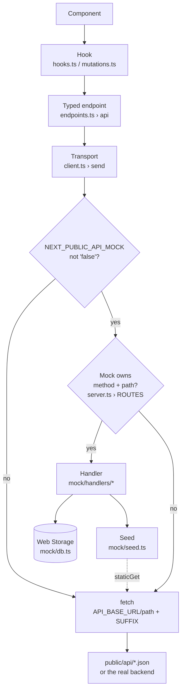

# Data and API layer

How data reaches the screens: the reference data in `public/api`, the in-browser mock server that
answers every server-owned endpoint, the transport that chooses between them, and the TanStack
Query hooks components use. The endpoint-by-endpoint contract for backend developers is in
[api-contract.md](api-contract.md).

## Contents

- [Overview](#overview)
- [Reference data](#reference-data)
- [Who answers each endpoint](#who-answers-each-endpoint)
- [Transport](#transport)
- [Configuration](#configuration)
- [Queries and read hooks](#queries-and-read-hooks)
- [Mutations](#mutations)
- [Build-time prefetch](#build-time-prefetch)
- [Mock server internals](#mock-server-internals)
- [Screen copy (content API)](#screen-copy-content-api)
- [Branches and regions](#branches-and-regions)
- [Switching to a real backend](#switching-to-a-real-backend)
- [Related](#related)

## Overview

All data goes through the API layer in [`src/api`](../src/api). There is no backend yet, so two
sources stand in for it:

- **Reference data** (brand, branches, menus, promotions, floor plans, help topics, screen copy) is
  dummy JSON in [`public/api`](../public/api), served by the static site like real endpoints
  (`GET /api/branches.json`).
- **Server-owned data** (sessions, OTP, orders, payments, service requests, everything under
  `/admin`) comes from the in-browser mock server in [`src/api/mock`](../src/api/mock). It
  implements the backend contract in [`src/api/contracts.ts`](../src/api/contracts.ts) and returns
  exactly those shapes.

Components never call the transport. The layers are:

| Layer         | File                                                  | Role                                    |
| ------------- | ----------------------------------------------------- | --------------------------------------- |
| Read hooks    | [`src/api/hooks.ts`](../src/api/hooks.ts)             | `useMenu()`, `useOrder(id)`, …          |
| Write hooks   | [`src/api/mutations.ts`](../src/api/mutations.ts)     | `useCreateOrder()`, …; cache updates    |
| Query options | [`src/api/queries.ts`](../src/api/queries.ts)         | Query keys, `staleTime`, polling        |
| Endpoints     | [`src/api/endpoints.ts`](../src/api/endpoints.ts)     | One typed function per endpoint (`api`) |
| Contract      | [`src/api/contracts.ts`](../src/api/contracts.ts)     | Request, response and error types       |
| Transport     | [`src/api/client.ts`](../src/api/client.ts)           | Mock server or `fetch`; `ApiError`      |
| Mock server   | [`src/api/mock/server.ts`](../src/api/mock/server.ts) | Routes and handlers                     |



## Reference data

Each file in `public/api` is one `GET` endpoint. The types in [`src/types`](../src/types) describe
each response.

| Endpoint                       | File                            | Type               |
| ------------------------------ | ------------------------------- | ------------------ |
| `GET /restaurant`              | `restaurant.json`               | `Restaurant`       |
| `GET /branches`                | `branches.json`                 | `Branch[]`         |
| `GET /branches/:id/menu`       | `branches/<id>/menu.json`       | `MenuData`         |
| `GET /branches/:id/promotions` | `branches/<id>/promotions.json` | `BranchPromotions` |
| `GET /branches/:id/floors`     | `branches/<id>/floors.json`     | `FloorPlanLayout`  |
| `GET /orders`                  | `orders.json`                   | `OrdersResponse`   |
| `GET /help`                    | `help.json`                     | `HelpTopics`       |
| `GET /content/<ns>`            | `content/<ns>.json`             | `ContentMap[ns]`   |

What each file holds:

- **`restaurant.json`**: the brand: name, tagline, `defaultBranchId` and social links.
- **`branches.json`**: every location: name, address, contact, image, opening hours and weekly
  `schedule`, status, table range, prep time, order modes, ordering rules, and the region rules
  (locale, currency, time zone, mobile rules, tax, payment methods, dietary marks). See
  [Branches and regions](#branches-and-regions).
- **`branches/<id>/menu.json`**: categories, dishes and curated lists (`chefsPicks`,
  `popularSearches`, `cartSuggestions`, `trendingTonight`, `popularAtTable`) in the branch's
  currency.
- **`branches/<id>/promotions.json`**: promo codes and automatic offers (for example happy hour).
- **`branches/<id>/floors.json`**: the areas in walking order, each with its tables and seats. It
  is the mock server's seed for the floor plan; staff screens read `GET /admin/branches/:id/tables`.
- **`orders.json`**: the mock server's seed only: `history` (the orders drawn in the designs, each
  with its `branchId`) and `riders` by branch. Screens never read it directly.
- **`help.json`**: the Payment help and Allergens & FAQs dialogs.
- **`content/*.json`**: screen copy, one namespace per area. See
  [Screen copy](#screen-copy-content-api).

The demo data has two branches: `blr-indiranagar` and `ktm-thamel`.

## Who answers each endpoint

With the mock on, [`server.ts`](../src/api/mock/server.ts) `ROUTES` decides. A request whose method
and path match a route goes to its handler; anything else falls through to `fetch`, which with the
default configuration reads the static file.

| Endpoint                                   | Answered by | Why                                    |
| ------------------------------------------ | ----------- | -------------------------------------- |
| `GET /branches`                            | Mock server | Staff settings, added branches, status |
| `GET /branches/:id/menu`                   | Mock server | Staff menu changes (sold out, edits)   |
| `GET /branches/:id/promotions`             | Mock server | Added branches inherit their source's  |
| Every write, every `/admin/*` endpoint     | Mock server | Server-owned data                      |
| `GET /orders/:id`, session and table lists | Mock server | Server-owned data                      |
| `GET /restaurant`, `/help`, `/content/*`   | Static file | Pure reference data                    |
| `GET /branches/:id/floors`, `GET /orders`  | Static file | Read only as the mock server's seed    |

The three mock-owned reference endpoints build on the static files: the mock reads the published
JSON over HTTP with `staticGet` and layers staff changes on top. See
[Seed layering](#seed-layering).

## Transport

[`src/api/client.ts`](../src/api/client.ts) exposes the only functions that send requests:

| Function                         | Purpose                                            |
| -------------------------------- | -------------------------------------------------- |
| `apiGet<T>(path, init?)`         | GET and parse the JSON body                        |
| `apiPost<T>(path, body, init?)`  | POST a JSON body                                   |
| `apiPatch<T>(path, body, init?)` | PATCH a JSON body                                  |
| `apiDelete(path, init?)`         | DELETE; resolves with no body (204)                |
| `staticGet<T>(path)`             | Mock only: GET over HTTP even while the mock is on |

- `path` is relative to the API base, for example `orders/A105`. `init` carries extra headers; the
  admin endpoints pass `Authorization: Bearer <token>` (see `bearer()` in `endpoints.ts`).
- With the mock on, `send()` dynamically imports `mock/server` on first use, so a backend build
  never loads it. Header names reach handlers in lower case.
- Any non-2xx response throws `ApiError` with `status`, `url`, the parsed `body`
  (`ApiErrorBody`) and a `code` getter for `body.error`.
- `isApiError(error, code)` narrows an unknown error to a specific contract code:

```ts
try {
  await verifyOtp.mutateAsync({ sessionId, phone, code });
} catch (error) {
  if (isApiError(error, 'otp_wrong_code')) showAttemptsLeft(error.body?.attemptsLeft);
}
```

The query client ([`src/api/queryClient.ts`](../src/api/queryClient.ts)) retries a failed query
once, but never on a 4xx `ApiError`. Defaults: `staleTime` 60 s, no refetch on window focus unless
a query opts in. The browser keeps one client for the life of the tab.

## Configuration

[`src/api/config.ts`](../src/api/config.ts) reads these at call time (Next inlines them at build
time), so tests can switch them.

| Variable                          | Default   | Effect                                         |
| --------------------------------- | --------- | ---------------------------------------------- |
| `NEXT_PUBLIC_API_MOCK`            | on        | `"false"` sends every request to the backend   |
| `NEXT_PUBLIC_API_BASE_URL`        | `/api`    | Base of every request URL                      |
| `NEXT_PUBLIC_API_SUFFIX`          | `.json`   | Appended to every path; `""` for a backend     |
| `NEXT_PUBLIC_API_MOCK_LATENCY_MS` | `200-400` | Mock delay range in ms, or one number          |
| `NEXT_PUBLIC_ADMIN_DEMO`          | on in dev | `"false"` disables the demo floor and bookings |

`apiUrl(path)` builds `${API_BASE_URL}/${path}${API_SUFFIX}`, so `branches/blr-indiranagar/menu`
becomes `/api/branches/blr-indiranagar/menu.json` by default. The mock delay is stable per endpoint
(a hash of method and path within the range) so runs are repeatable; unit tests use `0`.

## Queries and read hooks

Query options live in [`queries.ts`](../src/api/queries.ts); hooks in
[`hooks.ts`](../src/api/hooks.ts) wrap them.

### Reference data

These use `useSuspenseQuery`, so `data` is never undefined. The cache is filled at build time (see
[Build-time prefetch](#build-time-prefetch)).

| Query                       | Key                              | Freshness         | Hook              |
| --------------------------- | -------------------------------- | ----------------- | ----------------- |
| `contentQuery(ns)`          | `['content', ns]`                | Infinity          | `useContent(ns)`  |
| `restaurantQuery()`         | `['restaurant']`                 | Infinity          | `useRestaurant()` |
| `branchesQuery()`           | `['branches']`                   | 60 s, polled 60 s | `useBranches()`   |
| `branchMenuQuery(id)`       | `['branches', id, 'menu']`       | 60 s              | `useMenu()`       |
| `branchPromotionsQuery(id)` | `['branches', id, 'promotions']` | 60 s              | `usePromotions()` |
| `branchFloorsQuery(id)`     | `['branches', id, 'floors']`     | 60 s              | none (mock seed)  |
| `orderHistoryQuery()`       | `['orders', 'history']`          | Infinity          | none (mock seed)  |
| `helpQuery()`               | `['help']`                       | Infinity          | `useHelpTopics()` |

- `branchesQuery` and `branchMenuQuery` also refetch on window focus: staff pause the branch or
  mark dishes sold out during service, and guests see it within a minute.
- Derived hooks: `useBranch()` (the active branch: the session's, else the brand default),
  `useRegion()` (`{ money, clock, mobile }` for the active branch) and `useBranchDataLoaded(id)`
  (true once a branch's menu and promotions are cached, so switching branch never suspends).
- `useMenu()` returns a `MenuCatalog` (`lib/menu.ts › createMenuCatalog`) with lookups such as
  `getDish`, `dishesIn` and `searchDishes`; it is the same object until the menu data changes.

### Server-owned reads

These use `useQuery` and load on the client only (`pending` in the prerendered HTML, so hydration
never mismatches). Guest reads use `staleTime: 0` and refetch on mount and on window focus.
Calculations the server owns (delivery quote, promo quote) are read like queries.

| Query                                     | Key (prefix)                         | Polling             |
| ----------------------------------------- | ------------------------------------ | ------------------- |
| `orderQuery(id)`                          | `['orders', 'detail', id]`           | 30 s while `live`   |
| `sessionOrdersQuery(sessionId)`           | `['orders', 'session', sessionId]`   | 30 s while any live |
| `tableOrdersQuery(branch, table, on)`     | `['orders', 'table', branch, table]` | none                |
| `serviceRequestsQuery(sessionId)`         | `['service-requests', sessionId]`    | 15 s                |
| `deliveryQuoteQuery(branch, area, total)` | `['delivery-quote', …]`              | none (60 s fresh)   |
| `promoQuoteQuery(sessionId, code, lines)` | `['promo-quote', …]`                 | none (60 s fresh)   |

| Hook                             | Endpoint                              |
| -------------------------------- | ------------------------------------- |
| `useOrder(id)`                   | `GET /orders/:id`                     |
| `useSessionOrders(sessionId)`    | `GET /sessions/:id/orders`            |
| `useTableOrders(b, t, on)`       | `GET /tables/:branchId/:table/orders` |
| `useServiceRequests(id)`         | `GET /sessions/:id/service-requests`  |
| `useDeliveryQuote(area, total)`  | `POST /delivery/quote`                |
| `usePromoQuote(id, code, lines)` | `POST /promos/validate`               |

Each is idle (TanStack `skipToken`) until its inputs exist: no id, no session or no code means no
request.

### Staff reads

Staff queries take the admin token from `hooks/useAdminSession` and are idle while signed out or
without a branch. Keys end with the token, so another sign-in reads afresh. Floor queries share the
`['admin', 'service']` prefix, so invalidating it refreshes all of them.

| Hook                    | Key (prefix)                              | Polling       | Endpoint              |
| ----------------------- | ----------------------------------------- | ------------- | --------------------- |
| `useAdminBranches()`    | `['admin', 'branches', token]`            | none (60 s)   | `GET /admin/branches` |
| `useBranchService(id)`  | `['admin', 'service', id, token]`         | 15 s          | `…/service`           |
| `useFloorPlan(id)`      | `['admin', 'service', 'tables', …]`       | 15 s          | `…/tables`            |
| `useTableDetail(id, t)` | `['admin', 'service', 'table', …]`        | 15 s          | `…/tables/:table`     |
| `useBranchOrders(id)`   | `['admin', 'service', 'orders', …]`       | 15 s          | `…/orders`            |
| `useReservations(id)`   | `['admin', 'service', 'reservations', …]` | 15 s          | `…/reservations`      |
| `useFloorLayout(id)`    | `['admin', 'floor-layout', id, token]`    | none (60 s)   | `…/floors`            |
| `useBranchSettings(id)` | `['admin', 'settings', id, token]`        | none (60 s)   | `…/settings`          |
| `useTableQrCodes(id)`   | `['admin', 'qr-codes', id, token]`        | none (10 min) | `…/tables/qr-codes`   |

`…` stands for `/admin/branches/:branchId`. Polled staff queries also refetch on window focus.
`useDemoAdminAccount()` exposes the mock's demo login to the sign-in page, and is always `null` with
the mock off.

## Mutations

Every write is a hook in [`mutations.ts`](../src/api/mutations.ts). Each one updates or invalidates
the affected reads itself, so screens never manage the cache.

### Guest

| Hook                        | Endpoint                       | Cache effect afterwards                          |
| --------------------------- | ------------------------------ | ------------------------------------------------ |
| `useStartSession()`         | `POST /sessions`               | None; retried twice                              |
| `useUpdateSession()`        | `PATCH /sessions/:id`          | None                                             |
| `useSendOtp()`              | `POST /otp`                    | None                                             |
| `useVerifyOtp()`            | `POST /otp/verify`             | None                                             |
| `useValidatePromo()`        | `POST /promos/validate`        | Stores the quote as the cart's promo quote       |
| `useCreatePayment()`        | `POST /payments`               | On error: see below                              |
| `useSimulatePayment()`      | `POST /payments/:id/simulate`  | Paid bill: stores orders, `['service-requests']` |
| `useCreateOrder()`          | `POST /orders`                 | Stores the order, invalidates `['orders']`       |
| `useAddRound()`             | `POST /orders/:id/rounds`      | Stores the order, invalidates `['orders']`       |
| `useChangeOrder()`          | `PATCH /orders/:id`            | Stores the order, invalidates `['orders']`       |
| `useCancelOrder()`          | `POST /orders/:id/cancel`      | Stores the order, invalidates `['orders']`       |
| `useCreateServiceRequest()` | `POST /service-requests`       | Replaces that kind in the pending list           |
| `useCancelServiceRequest()` | `DELETE /service-requests/:id` | Optimistic removal; refetched on error           |

Error handling built into the hooks:

- `window_closed` or `order_closed` on a round, change or cancel invalidates `['orders']`, so the
  screen shows the order as it now stands.
- A promo refusal (`PROMO_REFUSALS` in `lib/promotions`) on `POST /orders` or `POST /payments`
  invalidates `['promo-quote']`, so the cart explains why.
- `nothing_to_pay` on `POST /payments` invalidates `['orders']`.

### Staff

Unless noted, a staff mutation invalidates `['admin', 'service']` and `['orders']` when it settles
(`refreshFloor`).

| Hook                        | Endpoint                                       | Cache effect                           |
| --------------------------- | ---------------------------------------------- | -------------------------------------- |
| `useAdminLogin()`           | `POST /admin/sessions`                         | None; the page stores the session      |
| `useAcknowledgeRequest()`   | `POST /admin/service-requests/:id/acknowledge` | Optimistic; + `['service-requests']`   |
| `useResolveRequest()`       | `POST /admin/service-requests/:id/resolve`     | Optimistic; + `['service-requests']`   |
| `useMarkServed()`           | `POST /admin/orders/:id/served`                | Optimistic; + `['orders']`             |
| `useSetKitchenStatus()`     | `PATCH …/orders/:id/rounds/:round/status`      | Optimistic on orders; floor            |
| `useTakeTableOrder()`       | `POST …/tables/:table/orders`                  | Floor                                  |
| `useAddStaffRound()`        | `POST …/orders/:id/rounds`                     | Floor                                  |
| `useEditStaffRound()`       | `PATCH …/orders/:id/rounds/:round`             | Floor                                  |
| `useCollectPayment()`       | `POST …/orders/:id/payment`                    | Floor                                  |
| `useCollectTablePayment()`  | `POST …/tables/:table/payment`                 | Floor                                  |
| `useRefundOrder()`          | `POST …/orders/:id/refund`                     | Floor                                  |
| `useCancelByStaff()`        | `POST …/orders/:id/cancel`                     | Floor                                  |
| `useFreeTable()`            | `POST …/tables/:table/free`                    | Floor                                  |
| `useSaveReservation()`      | `POST …/reservations` or `PATCH …/:id`         | Floor                                  |
| `useSetReservationStatus()` | `PATCH …/reservations/:id/status`              | Floor                                  |
| `useSetDishAvailability()`  | `PATCH …/menu/dishes/:slug/availability`       | Optimistic on menu; menu               |
| `useSaveDish()`             | `POST …/menu/dishes` or `PATCH …/:slug`        | Menu                                   |
| `useRemoveDish()`           | `DELETE …/menu/dishes/:slug`                   | Menu                                   |
| `useReorderDishes()`        | `PATCH …/menu/categories/:id/order`            | Stores the menu; menu                  |
| `useUpdateCategories()`     | `PATCH …/menu/categories`                      | Stores the menu; menu                  |
| `useUploadDishImage()`      | `POST …/menu/images`                           | None                                   |
| `useUpdateFloors()`         | `PATCH …/floors`                               | Stores layout; `['admin']`, branches   |
| `useSetBranchStatus()`      | `PATCH …/status`                               | `['admin', 'branches']`, branches      |
| `useUpdateBranchSettings()` | `PATCH …/settings`                             | Stores settings; `['admin']`, branches |
| `useCreateBranch()`         | `POST /admin/branches`                         | `['admin']`, branches                  |
| `useRemoveBranch()`         | `DELETE /admin/branches/:branchId`             | `['admin']`, branches                  |

- `…` stands for `/admin/branches/:branchId`. "Floor" means `['admin', 'service']` and
  `['orders']`; "menu" means the branch's `['branches', id, 'menu']`; "branches" means the exact
  `['branches']` key.
- "Optimistic" mutations patch the cached data in `onMutate` and restore the previous value if the
  server refuses (`useOptimisticService` for the waiter queue; `withKitchenStep` and
  `withAvailability` for the kitchen board and the menu).
- A staff mutation called while signed out throws a local `ApiError(401, 'unauthorized')` without
  sending a request.

## Build-time prefetch

The static export has no runtime server, so [`src/api/server.ts`](../src/api/server.ts) reads the
same JSON from disk at build time (`readApiFile(endpoint)` reads `public/api/<endpoint>.json`).

- `prefetchAppData(client)` runs in `app/layout.tsx` and fills the cache with every content
  namespace, the restaurant, the branches and the **default** branch's menu and promotions. The
  root layout dehydrates it into every page, so it stays small.
- The branches and the menu are stored with `updatedAt: 0`: already stale in the page, so the
  browser reads the live status and staff menu changes once the page opens.
- Another branch's menu and promotions are read in the browser; `GuestSessionProvider` waits for
  them (`useBranchDataLoaded`) before switching the active branch.
- `prefetchHelp(client)` is used by the help layout only.
- `getContent(ns)` gives server code (metadata) a translator.
- `getDishSlugsServer()` and `getCategoryIdsServer()` return the union over every branch's menu for
  `generateStaticParams`; `getDishServer(slug)` and `getCategoryServer(id)` serve
  `generateMetadata` (default branch first).

## Mock server internals

[`server.ts`](../src/api/mock/server.ts) maps method and path to a handler. `handleMockRequest`
returns `null` for a route it does not own; otherwise it waits the configured latency, round-trips
the body through JSON (handlers and callers never share objects), and turns a thrown
`MockHttpError` (`fail(status, code, extras)` in [`context.ts`](../src/api/mock/context.ts)) into
an error response.

A handler receives a `MockContext` (`db`, `seed`, `now()`, `newId()`) and a `MockRequest`
(`params`, `body`, `headers`). Tests construct their own context with a fixed clock and ids.

### Database

[`db.ts`](../src/api/mock/db.ts) keeps one table per resource in `localStorage`, validated on every
read (a malformed table reads as empty). Without storage, a table lives in memory for the tab.
Orders and service requests keep the keys the app used before the mock existed, so a device's data
carries over. `MOCK_KEYS`:

| Table             | Storage key                   | Holds                                      |
| ----------------- | ----------------------------- | ------------------------------------------ |
| `sessions`        | `olive.mock.sessions.v1`      | Guest sessions                             |
| `otp`             | `olive.mock.otp.v1`           | OTP state per session                      |
| `orders`          | `olive.orders.v1`             | Orders placed on this device               |
| `payments`        | `olive.mock.payments.v1`      | Payment requests                           |
| `adminSessions`   | `olive.mock.adminSessions.v1` | Staff sessions issued                      |
| `branchStatus`    | `olive.mock.branchStatus.v2`  | Status staff set, by branch                |
| `serviceRequests` | `olive.service.v1`            | Waiter and bill requests                   |
| `tablesFreed`     | `olive.mock.tablesFreed.v1`   | When each table was freed                  |
| `menuChanges`     | `olive.mock.menu.v2`          | Staff dish and category changes, by branch |
| `reservations`    | `olive.mock.reservations.v1`  | Bookings, by branch                        |
| `floorLayouts`    | `olive.mock.floorLayouts.v1`  | Saved floor plans, by branch               |
| `branchSetup`     | `olive.mock.branches.v1`      | Branches changed, added and removed        |

Because the tables are in `localStorage`, staff pages in another tab of the same browser see the
guest's orders and requests. They do not cross devices: a table's bill knows only this device's
orders plus the drawn history, and order numbers are counted per device.

### Seed layering

[`seed.ts`](../src/api/mock/seed.ts) (`querySeed`) gives handlers the reference data a backend would
keep in its database. It reads the published JSON through the query cache (normally already
prefetched) and applies staff changes on top:

1. **Branches.** `branches.json` (read with `staticGet`), with `branchSetup` applied: saved
   branches replace their originals, added branches are appended, removed ones dropped
   (`branchConfigs()`).
2. **Today's hours.** `withSchedule` derives today's hours, last orders and closed days from each
   branch's weekly `schedule` in its time zone.
3. **Status.** `withStatus` applies the status staff set (`branchStatus`): paused until a time,
   closed for the day, or open.
4. **Tables.** `withTables` widens the branch's table range to every table on the saved floor plan
   (so a new table's QR code scans) and lists out-of-service tables in `tables.outOfService`.

The result is what the mock's `GET /branches` returns. Other seeds:

- **Menu** (`menuData`): the published menu of the branch (or of the branch it was copied from)
  with `menuChanges` applied (`menuChanges.ts › applyMenuChanges`).
- **Promotions**: the published file of the branch or its source.
- **Floors**: the saved `floorLayouts` entry, else the published `floors.json`.
- **Orders**: `orders.json` as published (history and riders).
- **Order labels**: words written into new orders, from the content namespaces.

### Handlers

| File                            | Resource                                         |
| ------------------------------- | ------------------------------------------------ |
| `handlers/sessions.ts`          | Guest sessions                                   |
| `handlers/otp.ts`               | OTP send and verify                              |
| `handlers/orders.ts`            | Place, read and list orders                      |
| `handlers/orderChanges.ts`      | Rounds, changes, guest cancellations             |
| `handlers/orderPricing.ts`      | Line and fulfilment checks; delivery quote       |
| `handlers/payments.ts`          | Payment requests and the simulated partner       |
| `handlers/promos.ts`            | Promo validation; branch promotions              |
| `handlers/serviceRequests.ts`   | Guest waiter and bill requests                   |
| `handlers/adminSessions.ts`     | Staff sign-in, branch list, branch status        |
| `handlers/adminSettings.ts`     | Branch settings; create and remove branches      |
| `handlers/adminService.ts`      | Waiter home, acknowledge, resolve, served        |
| `handlers/adminTables.ts`       | Floor plan, table detail, QR codes, free, floors |
| `handlers/adminOrders.ts`       | Staff orders, rounds, payments, refunds, cancel  |
| `handlers/adminReservations.ts` | Bookings                                         |
| `handlers/adminMenu.ts`         | Menu edits; `GET /branches`, `GET …/menu`        |
| `handlers/kitchen.ts`           | Kitchen round status                             |

Shared rules live beside them: [`rules.ts`](../src/api/mock/rules.ts) (session 6 h, staff session
12 h, OTP `123456`, 3 attempts, 30 s resend, payment window 272 s, requests lapse after 30 min),
`kitchen.ts` (simulated kitchen timing), `promos.ts` (code checks and per-guest uses), `tab.ts`
(re-pricing a running order and settling its payment), `branchStatus.ts`, `menuChanges.ts`,
`tableService.ts` (out-of-service tables) and `orderBuilder.ts`.

### Development-only data

Under `npm run dev` only, `demoFloor.ts` adds sample orders and requests to the floor endpoints and
`demoReservations.ts` seeds sample bookings for a branch with none. Neither runs in a build or in
tests; `NEXT_PUBLIC_ADMIN_DEMO=false` disables them in development. `demoAdmin.ts` holds the demo
staff account the sign-in page offers while the mock is on.

## Screen copy (content API)

All on-screen text lives in `public/api/content/<namespace>.json`, one endpoint per area:
`common`, `home`, `menu`, `cart`, `checkout`, `orders`, `service`, `status` and `kitchen`
(`CONTENT_NAMESPACES` in `queries.ts`). Keys are nested by screen and typed from the JSON
(`ContentMap`), so a missing key is a compile error.

```tsx
const t = useContent('checkout');
t('verify.title'); // "Verify your number"
t('summary.eta', { time: prepTime }); // fills {time}
t.plural('itemCount', 3); // { one, other } -> "3 items"
t.rich('verify.sentTo', { b: (c) => <b>{c}</b> }, { phone }); // tags become elements
t.get('faq.items'); // raw lists and objects
```

- The translator is built by [`translator.ts`](../src/api/translator.ts) (`createTranslator`).
- Server code uses `const t = await getContent('orders')`.
- Unit tests wrap components in `TestProviders` ([`tests/apiState.tsx`](../tests/apiState.tsx)),
  which seeds every namespace from the same JSON.
- To change wording, edit the JSON. A backend can later serve the same shape per language.

## Branches and regions

Every rule that differs by place is data on the branch (`GET /branches`,
[`src/types/branch.ts`](../src/types/branch.ts)). No currency symbol, locale, time zone, dial code,
tax rate or payment method is hard-coded in `src`. Adding a region means adding a branch, its menu
file and any copy its keys name; `tests/unit/branches.test.ts` checks that every key the data names
exists.

| Concern          | Branch fields                                       | Consumed by                  |
| ---------------- | --------------------------------------------------- | ---------------------------- |
| Money            | `locale`, `localeFallback`, `currency`              | `lib/money.ts › createMoney` |
| Time             | `timezone`, `locale`                                | `lib/clock.ts › createClock` |
| Phone            | `mobile`                                            | `lib/phone.ts`, `PhoneInput` |
| Tax              | `tax`                                               | `lib/pricing.ts`             |
| Payments         | `payments` (`checkout`, `bill`, `atTable`)          | `lib/payments.ts`            |
| Dietary marks    | `dietary.marks`                                     | Filters and sidebar          |
| Hours and status | `schedule`, `opensAt`, `closesAt`, `status`, …      | Headers, status screens      |
| Order modes      | `modes` (dine-in, takeaway, delivery zones, pickup) | Mode picker, checkout        |
| After ordering   | `ordering` (`dineInPayment`, `cancelWindowSeconds`) | Rounds, change window        |
| Tables           | `tables` (range, `outOfService`)                    | QR scan, sessions            |
| Region words     | `currency.nameKey`, `tax.invoiceKey`                | `hooks/useRegionCopy`        |

Components read the active branch with `useBranch()` and its formatters with `useRegion()`; pure
lib functions take a `Branch`, `Money` or `Clock` argument. The price filter lives in the branch's
menu (`priceFilter`), and promo codes and offers in its promotions file.

## Switching to a real backend

1. Implement the contract in [api-contract.md](api-contract.md) (types and JSDoc in
   [`contracts.ts`](../src/api/contracts.ts)), including the reference endpoints: `GET /restaurant`,
   `/branches`, `/branches/:id/menu`, `/branches/:id/promotions`, `/branches/:id/floors`, `/help`
   and `/content/<namespace>` with the same keys as `public/api/content/*.json`.
2. Set the environment and rebuild:

   ```sh
   NEXT_PUBLIC_API_MOCK=false
   NEXT_PUBLIC_API_BASE_URL=https://api.example.com
   NEXT_PUBLIC_API_SUFFIX=
   ```

   Every request then goes to `${NEXT_PUBLIC_API_BASE_URL}/<path>`, and the mock server is never
   loaded. The demo login disappears from the sign-in page.

3. Replace the simulated payment result: settle payments with the payment partner's webhook and
   have the app poll or subscribe for the payment's status instead of calling
   `POST /payments/:id/simulate`. That status read is not yet part of the contract.
4. In [`server.ts`](../src/api/server.ts), replace `readApiFile` with `apiGet` for build-time reads,
   or drop the build-time prefetch if pages become dynamic. Order pages already take any id
   (`?id=`).
5. Send real ISO `placedAt` timestamps on orders; `placedRelative` and its branch in
   [`adapters.ts`](../src/api/adapters.ts) can then be removed.
6. Issue signed QR tokens (`GET /admin/branches/:id/tables/qr-codes`) and verify them on
   `POST /sessions`; the mock's tokens are not signed.
7. Delete `src/api/mock`, `staticGet` and `useDemoAdminAccount` once nothing depends on them.

## Related

- [README](README.md)
- [Architecture](architecture.md)
- [Conventions](conventions.md)
- [Testing](testing.md)
- [Guest app](guest-app.md)
- [Staff app](staff-app.md)
- [Settings](settings.md)
- [Data and API](data-and-api.md)
- [API contract](api-contract.md)
- [Masters and config](masters-and-config.md)
- [How-to guides](how-to.md)
- [Roadmap](roadmap.md)
