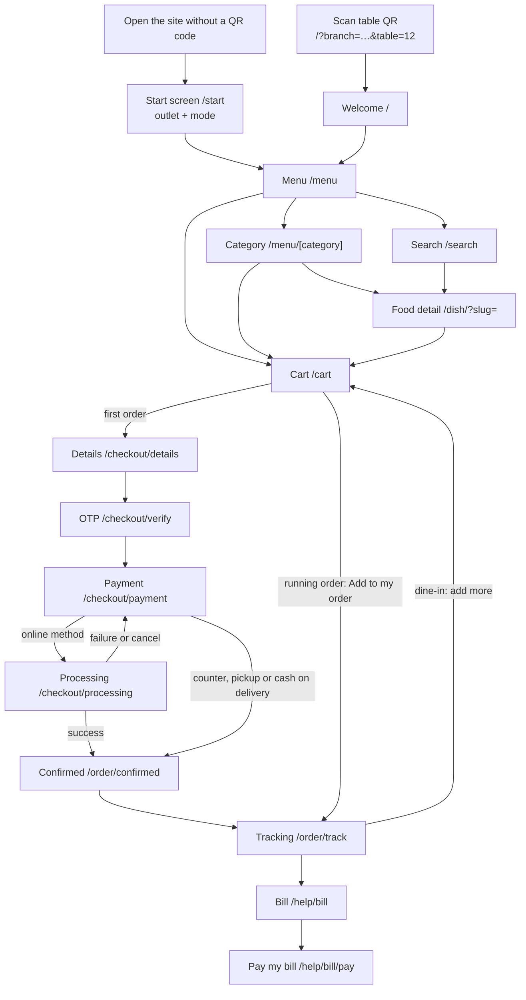
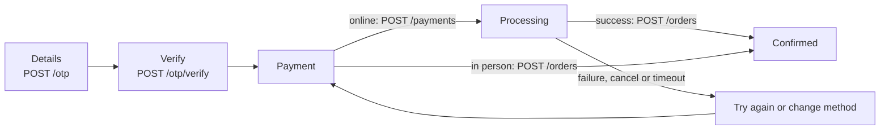
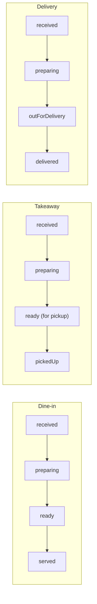

# Guest app

The guest app is everything a diner sees: they scan a table QR code (or choose an outlet), browse
that branch's menu, build a cart, check out with a verified mobile number and follow the order
until it is served, collected or delivered. This page walks through it in the order a guest meets
it and points at the code that owns each rule.

## Contents

- [Overview and screen map](#overview-and-screen-map)
- [Guest sessions](#guest-sessions)
- [Order modes: dine-in, takeaway, delivery](#order-modes-dine-in-takeaway-delivery)
- [Menu, search and food detail](#menu-search-and-food-detail)
- [Cart](#cart)
- [Pricing and the tax engine](#pricing-and-the-tax-engine)
- [Promotions](#promotions)
- [Checkout](#checkout)
- [Order tracking](#order-tracking)
- [After ordering](#after-ordering)
- [Help, waiter and bill requests](#help-waiter-and-bill-requests)
- [Restaurant status and connectivity](#restaurant-status-and-connectivity)
- [Branches and regions](#branches-and-regions)
- [Related](#related)

## Overview and screen map

Every guest route is prerendered at build time (static export). Pages that depend on the URL,
browser storage or server-owned data read them after hydration, so the prerendered HTML and the
first client render always match. Server-owned data (sessions, OTP, orders, payments, service
requests) goes through `src/api`; in this build the in-browser mock server in
[`src/api/mock`](../src/api/mock) answers as the contract in
[`src/api/contracts.ts`](../src/api/contracts.ts) describes.

| Route                    | Screen                                                    | Component                 |
| ------------------------ | --------------------------------------------------------- | ------------------------- |
| `/`                      | Welcome; status screen when not open; start screen        | `home/Home`               |
| `/start`                 | Choose outlet and mode; `?next=` returns afterwards       | `start/StartView`         |
| `/menu`                  | Menu home: chef's picks, then every category in full      | `menu/MenuHome`           |
| `/menu/[category]`       | Category list (one page per category id on any menu)      | `menu/CategoryView`       |
| `/dish/?slug=…`          | Food detail; `&edit=<lineKey>` edits a cart line          | `menu/DishDetail`         |
| `/search`                | Search and suggestions; `?q=`                             | `menu/SearchView`         |
| `/cart`                  | Cart, also "Adding to order" and "Editing order"          | `cart/CartView`           |
| `/checkout/details`      | Name, mobile, pickup time or delivery address             | `checkout/DetailsStep`    |
| `/checkout/verify`       | OTP                                                       | `checkout/VerifyStep`     |
| `/checkout/payment`      | Payment method                                            | `checkout/PaymentStep`    |
| `/checkout/processing`   | Payment in progress; `?state=payment-failed`/`-cancelled` | `checkout/ProcessingStep` |
| `/order/confirmed?id=`   | Order confirmation                                        | `order/OrderConfirmed`    |
| `/order/track?id=`       | Live tracking; cancelled screen when cancelled            | `order/OrderTracking`     |
| `/order?id=`             | Order details (receipt)                                   | `order/OrderDetails`      |
| `/orders`                | My orders                                                 | `order/MyOrders`          |
| `/help`                  | Help, Payment help and FAQ dialogs, Follow us             | `service/HelpView`        |
| `/help/bill`             | Request the bill                                          | `service/BillRequestView` |
| `/help/bill/pay`         | Pay my bill                                               | `service/PayBillView`     |
| `/help/waiter-requested` | Waiter requested                                          | `service/WaiterRequested` |
| `/help/bill-requested`   | Bill requested                                            | `service/BillRequested`   |

Components are under [`src/components`](../src/components). Two screens are dialogs, not routes:
the quick-add sheet (`QuickAddContext`) and the request-waiter sheet
(`useServiceRequest().openRequest('waiter')`).

Gotchas:

- Order pages are three static pages that read the id from `?id=` on the client
  (`components/order/useOrderId`), so any id the API returns opens. Always link with
  `orderPath(id, 'details' | 'track' | 'confirmed')` from [`src/lib/orders.ts`](../src/lib/orders.ts).
- `/checkout/*` is wrapped by [`src/app/(guest)/checkout/layout.tsx`](<../src/app/(guest)/checkout/layout.tsx>),
  which renders `OrderingGate`: while ordering is unavailable the status screen replaces the step.
- A guest without a session who opens any ordering page is sent to `/start/?next=…` by
  [`StartRedirect`](../src/components/start/StartRedirect.tsx); `/`, `/start`, `/styleguide` and
  `/admin/*` are exempt.

### The guest journey

## Guest sessions

Every guest who scans a table gets their own session, so several people at one table order, are
billed and pay separately. The session also fixes the branch (and so the menu, prices and rules)
and the order mode.

Where it lives:

- [`src/lib/scan.ts`](../src/lib/scan.ts): `parseScan` reads the link, `resolveScan` decides the
  outcome. Both are pure and unit-tested.
- [`src/context/GuestSessionContext.tsx`](../src/context/GuestSessionContext.tsx): applies the
  outcome, opens and saves sessions, exposes `useGuestSession()`, `useTable()` (via
  [`src/hooks/useTable.ts`](../src/hooks/useTable.ts)), `useVisit()` and `useVisitActions()`.
- [`src/lib/session.ts`](../src/lib/session.ts): storage validation (`isSavedSession`,
  `fromSaved`) and `isLiveSession`.
- Mock server: [`src/api/mock/handlers/sessions.ts`](../src/api/mock/handlers/sessions.ts)
  (`POST /sessions`, `PATCH /sessions/:id`).

### The link

A table QR link is `/?branch=ktm-thamel&table=12&qr=<token>`.

- `branch` is optional. Without it, or with an unknown id, the link is for the brand's
  `defaultBranchId` (`GET /restaurant`; `blr-indiranagar`, shown as "Udyog Vihar", Gurgaon).
- `table` counts only inside the branch's `tables` range (`tables.first`–`tables.last`).
- `qr` is an opaque token (`[\w.~-]{1,512}`) kept with the session for a future signed-token
  check. Nothing verifies it yet.
- `mode=takeaway|delivery` is an ordering link. It is ignored when the named branch has that mode
  switched off.

### How a link resolves (`resolveScan`)

| Link                           | Live saved session    | Outcome                                       |
| ------------------------------ | --------------------- | --------------------------------------------- |
| Valid `table`                  | Same branch and table | `keep` (re-scan or refresh)                   |
| Valid `table`                  | None, or elsewhere    | `start` a dine-in session at that table       |
| `table` that is out of service | Any                   | `choose`: start screen says the table is shut |
| `mode` (same or no branch)     | At that branch        | `keep`, or `change` the session's mode        |
| `mode` with another `branch`   | Any                   | `start` a session there in that mode          |
| `mode`, no branch              | None                  | `choose` with the mode preselected            |
| Only `branch`                  | At that branch        | `keep`                                        |
| Only `branch`                  | None, or elsewhere    | `choose` with that outlet preselected         |
| Nothing                        | Any live session      | `keep`                                        |
| Nothing                        | None                  | `choose` (start screen)                       |

### Rules

- New sessions come from the server: `POST /sessions` (`useStartSession()`), answered with
  `{ id, branchId, mode, table?, deliveryArea?, startedAt, expiresAt, qrToken? }`. Changing mode
  or delivery area is `PATCH /sessions/:id` and keeps the same session and cart.
- A session expires when the server says (`expiresAt`). The mock sets six hours
  (`TABLE_SESSION_HOURS` in [`src/api/mock/rules.ts`](../src/api/mock/rules.ts)). An expired or
  no-longer-valid session (branch removed, table outside the range) is ignored on load.
- Another branch is always another session, and so another cart, even at the same table number.
- The session is saved in localStorage `olive.session.v1`. A session still opening is kept in
  sessionStorage `olive.pending-scan.v1`, so a reload meanwhile opens the same one.
- When another tab starts or changes a session, every tab follows it (storage event).
- A saved session from before branches (no `branchId`) belongs to the default branch; one from
  before order modes (no `mode`) is dine-in.
- Everything personal is scoped to the session id: the cart, the checkout, waiter and bill
  requests, and new orders (`Order.sessionId`). Ownership is decided only by
  `isOwnOrder(order, sessionId)` in [`src/lib/orders.ts`](../src/lib/orders.ts).

Gotchas:

- `useTable()` and `useGuestSession()` return `null` in the prerendered HTML and the first client
  render. Screens show "Table —" (`useTableLabel()`) so a guest who scanned table 3 never sees the
  default table flash. Providers that work per session (cart, checkout, service requests) wait for
  the session; anything added to the cart meanwhile is kept.
- Only one session opens at a time (React Strict Mode runs the effect twice and reuses it).
- My orders still lists every order placed on the device, earlier sessions included; only the bill
  separates "mine" from "the table".

## Order modes: dine-in, takeaway, delivery

Each branch says which modes it offers and their rules (`modes` on `GET /branches`,
`BranchModes` in [`src/types/branch.ts`](../src/types/branch.ts)). Staff switch modes on and off
in Settings › Services (at least one must stay on; delivery needs a zone); guests then see only the
enabled ones, and the server refuses the others with `409 mode_unavailable`.

Where it lives:

- [`src/lib/fulfilment.ts`](../src/lib/fulfilment.ts): `branchModes`, `modePayments`,
  `findZone`, `quoteDelivery`, `deliverySummary`, `minimumOrder`, `etaMinutes`, `pickupOptions`,
  `isPickupSlot`. The mock server uses the same functions.
- Start screen: [`src/components/start`](../src/components/start) (`StartView`, `OutletList`,
  `ModeOptions`, `DeliveryAreaSelect`, `SwitchOutletDialog`).
- Header: `layout/VisitPill` and `layout/ModeSwitchDialog`.
- Cart and bill: `useOrderBill()` in [`src/hooks/useFulfilment.ts`](../src/hooks/useFulfilment.ts),
  `cart/DeliveryCard`, `cart/MinimumOrderNotice`.
- Checkout fields: `checkout/PickupTimePicker`, `checkout/AddressForm`,
  [`src/hooks/useSavedAddresses.ts`](../src/hooks/useSavedAddresses.ts).

### Starting and switching

- A table QR code is dine-in at that table. Dine-in is offered on the start screen only when a
  table was scanned at that outlet ("Scan the QR code on your table" otherwise).
- Without a session the start screen lists outlets (address, open or closed, hours, local time,
  modes), then the modes, then a delivery area for delivery.
- The header pill shows the table for dine-in and "Takeaway · Thamel" style text otherwise. It
  opens `ModeSwitchDialog`: switching mode is immediate and keeps the cart; "Change outlet" goes to
  the start screen, which asks before emptying the cart (`SwitchOutletDialog`).

### Takeaway

- `takeaway { enabled, prepMinutes, minOrder, asap, slotMinutes, payments }`.
- `pickupOptions(branch, now)` offers "as soon as possible" (`prepMinutes` from now, only while
  open and if it is ready before closing) and slots every `slotMinutes` from opening until
  closing, today, in the branch's time zone. The server re-checks with `isPickupSlot`
  (`pickup_unavailable`).
- Payment: the mode's own list, online methods or **Pay at pickup** (`pickup`).

### Delivery

- `delivery { enabled, prepMinutes, zones[], maxDistanceKm?, feeTaxable, payments }`; each zone is
  `{ id, name, areas[], fee, freeAbove?, minOrder, etaMinutes }`.
- The session carries `deliveryArea`. `POST /delivery/quote` (`useDeliveryQuote`) returns the zone,
  the fee (0 once the item total reaches `freeAbove`), the minimum and `shortBy`.
- The address form takes house and street, area (from the zones), landmark, rider instructions and
  a Home / Work / Other label. Addresses are remembered per branch in localStorage
  `olive.addresses.v1`.
- Payment: online methods or **Cash on delivery** (`cod`).

### Minimum order

- Takeaway uses `modes.takeaway.minOrder`; delivery uses the quoted zone's `minOrder`; dine-in has
  none.
- Below the minimum the cart shows "Add ₹X more to check out" and disables Checkout.
  `useCheckoutGuard` sends a guest without a delivery area or below the minimum back to `/cart`.
- Minimums, free-delivery thresholds and promo-code minimums are all measured on the item total
  **before** discounts.

Gotchas:

- Server refusals (`pickup_unavailable`, `area_not_served`, `below_minimum`) show a toast and
  return the guest to the step that fixes them
  ([`src/hooks/useOrderRejected.ts`](../src/hooks/useOrderRejected.ts)).
- Waiter and bill requests are dine-in only: those pages redirect to Help for other modes
  ([`src/hooks/useDineInOnly.ts`](../src/hooks/useDineInOnly.ts)) and the server answers
  `dine_in_only`.
- The demo India branch's delivery zones still name Bengaluru areas (Indiranagar, Koramangala…)
  although the branch is shown as Udyog Vihar, Gurgaon. That is demo data, not a code rule.

## Menu, search and food detail

The menu, category, search and food-detail screens all read the active branch's menu
(`useMenu()`, a `MenuCatalog` from [`src/lib/menu.ts`](../src/lib/menu.ts)). Filters and sort live
in `FiltersContext` (memory, per visit); the search query lives in `SearchContext` and the URL
(`?q=`, debounced by 250 ms).

- Diet filter chips come from the branch's `dietary.marks`; the price filter's limit is the
  menu's `priceFilter` ("Under ₹400").
- Search suggestions before typing: Trending tonight, Popular searches and all categories. There
  are no recent searches, by client request.
- Adding from a list ([`AddControl`](../src/components/menu/AddControl.tsx)): a dish with nothing
  to choose goes straight into the cart; a customisable dish opens the quick-add sheet.
  `isCustomisable` is true for more than one size, any option group, add-ons or removables.
- The food-detail page has the full options form; `?edit=<lineKey>` edits an existing cart line.
  After adding, the guest returns to where they came from.
- **Add feedback:** below 1024px the sticky cart bar
  ([`CartBar`](../src/components/layout/CartBar.tsx)) says "✓ Paneer Tikka added" for a moment
  (`ADDED_FLASH_MS`, 1.5 s, with a small bump) instead of a toast; the stepper that replaced ADD
  takes it back. Without a bar on screen (desktop, the cart page) a short toast says it
  (`CartContext › addItem`, `useAddedFlash`). Removing a line still offers Undo in a toast.
- Dishes that are sold out or off today show an unavailable label instead of ADD.

### Option types

| Field on a dish                       | What the guest sees                                | Example             |
| ------------------------------------- | -------------------------------------------------- | ------------------- |
| `variants`                            | Required size or portion tiles                     | Half / Full         |
| `optionGroups` with plain strings     | Free single choice as chips                        | Spice level         |
| `optionGroups` with `{ name, price }` | Priced single choice as rows ("Included" / "+₹90") | Curry protein       |
| `addOns`                              | Multi-select extras, optional `maxAddOns`          | Extra parmesan      |
| `removables`                          | Free "Leave out" chips                             | No onion, No garlic |
| `combo` + `optionGroups`              | A meal: one group per slot, "Meal · Save ₹X" badge | Veg Thali           |

- Add-ons, option groups and individual choices can take `availableFor: [variantIds]`; add-ons can
  take `priceByVariant`.
- When the size changes, `normaliseConfig` in [`src/lib/options.ts`](../src/lib/options.ts) drops
  anything the new size does not offer and re-defaults affected choices.
- Groups with `showInSummary` (meal slots, protein) are always listed in the cart; other groups
  only when the choice is not the default.

## Cart

The cart is device state scoped to the guest session: `CartContext` over the pure reducer in
[`src/lib/cartReducer.ts`](../src/lib/cartReducer.ts), saved in localStorage `olive.cart.v2` with
the session id.

- A cart saved under another session id is discarded. On load the cart is validated and
  re-priced against the menu; a malformed line is dropped. It is synced across tabs.
- The cart also holds the kitchen note, the applied `promoCode` and, while an order is being
  changed, `editing: { orderId, round, stash }` (the cart from before, restored afterwards).
- Read narrowly to avoid re-renders on long menus: `useDishLines(slug)` / `useDishQuantity(slug)`
  for one dish, `useCartActions()` for stable actions, `useCart()` only where the whole cart is
  shown.

### Cart line identity

`lineKey` in [`src/lib/cartLine.ts`](../src/lib/cartLine.ts) builds a line's key from the dish
slug, variant, sorted add-ons, options (sorted by group), sorted removals, sorted instructions and
the note (trimmed, lower-cased, whitespace collapsed).

- Adding the same configuration again increases that line's quantity.
- Editing a line so it matches another merges the two.
- The list stepper acts on the most recently added configuration of that dish.

## Pricing and the tax engine

`calculateBill(lines, branch, delivery?, discounts?)` in
[`src/lib/pricing.ts`](../src/lib/pricing.ts) turns cart lines into a bill under the branch's
`tax` rules. The mock server prices orders with the same function and is the authority; the cart
shows the same numbers.

Rules, in order:

1. Menu prices are whole major units, excluding tax. The engine works in minor units
   (`currency.minorUnit`, 100 for paise and paisa).
2. **Discounts** (`BillDiscount[]`: automatic offers first, then a promo code) never exceed the
   item total. With `tax.discountBeforeTax: true` (both demo branches) charges and taxes are worked
   out on the discounted item total; with `false` on the full item total, and the discounts come
   off the taxed total.
3. **Service charge** (`tax.serviceCharge`, optional) at `rateBp` basis points on that amount.
4. **Each tax line** at `rateBp` on its `base`: `items` or `itemsPlusService`. A line with
   `splitInto` (GST into CGST and SGST) is computed once, then split by the parts' rates; an odd
   minor unit goes to the first part.
5. **Delivery fee**: added to the total. When `modes.delivery.feeTaxable` is true it is also added
   to every tax base (never to the service charge's base). Both demo branches have it false.
6. **Rounding**: the total is rounded half up to `tax.rounding.unit` (100 = whole rupee); the
   difference is the round-off line.

Percentages use integer maths (`percentOf`, half up), so results are exact.

A branch that does not charge tax (Settings › Tax, `enabled` off) has no tax lines: its bills
list only the service charge (if any) and round off, carry `taxCharged: false`, and are titled
"Bill of supply" (India) or "Bill" (Nepal) instead of "GST invoice" / "VAT invoice"
(`tax.invoiceKey`). See [settings.md › Tax and service charge](settings.md#tax-and-service-charge).

The order page's **Get invoice** prints the same bill staff print from Payments (`useBillPrint` in
`components/admin/payments/PaymentPrint.tsx`, drawn for the order's branch): the branch, address,
phone and GSTIN/PAN, bill number and date, items, every charge, the total and payments taken,
with no browser header or footer.

[`PriceSummary`](../src/components/cart/PriceSummary.tsx) renders the bill. `billRows(bill, …)`
builds the rows above the total: item total, discounts, delivery fee, then every charge that
applies (service charge, each tax, round off). A charge the bill does not have is not listed, so
a branch without a service charge shows no service-charge row. `BillSummary` draws rows over a
total; staff screens and the printed bill reuse both. Variants: **split** (each tax part, CGST
and SGST, on its own line; cart and checkout), **receipt** (the same, a placed order's details),
**combined** (each tax as one line; the desktop cart panel) and **compact** (everything on top of
the items on one line, label from `tax.compactLabelKey`). With `collapsible`, only the total
shows, as a button with ⌄ that opens the rows (`aria-expanded`); the staff order popup uses it.
The guest's cart and checkout always list every charge openly.

### Worked example (India, `blr-indiranagar`)

GST 5% on items, split CGST 2.5% + SGST 2.5%, no service charge, rounded to ₹1. During happy hour
(20% off beverages) with `WELCOME10` applied. The cart holds two drinks at ₹179 and one main at
₹549.

| Step                               | Amount   |
| ---------------------------------- | -------- |
| Item total (2 × 179 + 549)         | ₹907.00  |
| Happy hour: 20% of ₹179 = ₹36, × 2 | −₹72.00  |
| WELCOME10: 10% of ₹835, cap ₹100   | −₹83.50  |
| Taxable (discount before tax)      | ₹751.50  |
| GST 5% (CGST ₹18.79 + SGST ₹18.79) | ₹37.58   |
| Gross                              | ₹789.08  |
| Round off                          | −₹0.08   |
| **Total**                          | **₹789** |

Without discounts the same rules give ₹1,356 → ₹1,424 (GST ₹67.80, round off +₹0.20).

Nepal (`ktm-thamel`) adds a 10% service charge and 13% VAT on items plus service:
रू 2,280 → service रू 228 → VAT 13% of रू 2,508 = रू 326.04 → रू 2,834.04 → **रू 2,834**
(round off −रू 0.04).

## Promotions

Each branch has promo codes and automatic offers (`GET /branches/:id/promotions`, from
`public/api/branches/<id>/promotions.json`; types in
[`src/types/promotion.ts`](../src/types/promotion.ts)). The rules are pure functions in
[`src/lib/promotions.ts`](../src/lib/promotions.ts); the mock applies the same ones
([`src/api/mock/promos.ts`](../src/api/mock/promos.ts),
[`handlers/promos.ts`](../src/api/mock/handlers/promos.ts),
[`handlers/orderPricing.ts`](../src/api/mock/handlers/orderPricing.ts)) and is the authority.

- **Promo codes**: `{ code, type: 'percent' | 'flat', value, minOrder, maxDiscount?, modes[],
validFrom?, validTo?, perGuestLimit?, descriptionKey }`.
- **Automatic offers**: `{ id, days[], from, to, scope: { categories?, dishes? }, type: 'percent' |
'flat' | 'priceOverride', value, labelKey }`. `from` / `to` are "HH:MM" branch time; a `to` at or
  before `from` runs past midnight and belongs to the day it started (`isOfferActive`).

| Demo data  | India (`blr-indiranagar`)                            | Nepal (`ktm-thamel`)        |
| ---------- | ---------------------------------------------------- | --------------------------- |
| Codes      | `WELCOME10` 10%, max ₹100, from ₹299, once per guest | `NAMASTE15` 15%, max रू 250 |
| Codes      | `FLAT50` ₹50 off delivery from ₹499                  | —                           |
| Happy hour | Daily 16:00–19:00 branch time, 20% off Beverages     | Same, Kathmandu time        |

How they add up:

- Offers come off each item first, the best one per line (`bestOffer`); they never stack on one
  line. A percentage is rounded to a whole unit per item, so offer prices are whole (₹179 → ₹143).
- The code comes off the item total after offers: a percentage capped at `maxDiscount`, a flat
  amount never more than the items (`promoDiscount`).
- Both come off before tax under `discountBeforeTax`.

In the app:

- **Menu**: while an offer is on (`useActiveOffers`, one shared minute timer, nothing in the
  prerendered HTML) covered dishes show the offer price, the struck-through menu price and a badge
  (`menu/OfferPrice`); menu and category pages show `menu/OfferBanner`.
- **Cart**: `cart/PromoCard` lists the outlet's codes for the current mode (`availablePromos`) and
  validates a typed code with `POST /promos/validate` (`useValidatePromo`). Refusals:
  `promo_invalid`, `promo_expired`, `promo_mode_not_eligible`, `promo_limit_reached`,
  `below_minimum`. `useOrderBill` re-prices the applied code with the server on every cart change
  (`usePromoQuote`); Checkout is disabled while that request is in flight.
- **Checkout to receipt**: `POST /payments` and `POST /orders` send `promoCode`; the server checks
  again. The order records `promoCode`, `discounts` and each item's `offer`, so the receipt shows
  the same lines and the confirmation says what was saved (`order/OrderSavings`).

Gotchas:

- An order paid online is priced as at its payment's `createdAt`, so a happy hour that ends while
  the guest pays still counts.
- The per-guest limit counts the guest's non-cancelled orders with the code across every session
  where their mobile number was verified.
- On a running dine-in order the code applies to the whole tab: every round re-prices it
  (`withRounds` in [`src/api/mock/tab.ts`](../src/api/mock/tab.ts)), so the cap and minimum apply
  to the tab. While adding a round or editing, the cart shows no code field.

## Checkout

Checkout collects the guest's name and verified mobile number, then payment. State lives in
[`src/context/CheckoutContext.tsx`](../src/context/CheckoutContext.tsx), saved in sessionStorage
`olive.checkout.v1` with the session id; it mirrors what the server answered and owns no rules.

1. **Details**: the name is required; the mobile number must match the branch's `mobile` rules
   ([`src/lib/phone.ts`](../src/lib/phone.ts), validation in
   [`src/lib/checkout.ts`](../src/lib/checkout.ts)). Takeaway adds the pickup time; delivery adds
   the address. **Send OTP** calls `submitDetails` → `POST /otp`.
2. **Verify**: the server checks the code. The mock accepts `123456`, allows 3 attempts
   (`OTP_ATTEMPTS`) and unlocks resend after 30 s (`OTP_RESEND_SECONDS`) or after a wrong code; an
   early resend is refused with `otp_resend_too_soon`. The app only checks that six digits are
   entered. A number verified earlier in the session stays verified. The number is shown with
   a pencil button that goes back to Details to change it.
3. **Payment**: the bill is shown in full above the methods (the mobile pay card in
   `PaymentStep`, the desktop aside `OrderSummaryPanel`): every charge, then the amount payable.
   The methods come from `modePayments(branch, mode)`: `payments.checkout` for
   dine-in, the mode's own list otherwise. An online method calls `usePayCheckout().start` →
   `POST /payments { purpose: 'order', … }`; the server prices the cart and opens a 4:32 window
   (`PAYMENT_WINDOW_SECONDS`). An in-person method (`counter`, `pickup`, `cod`) places the order
   immediately.
4. **Processing**: "Prototype: success" and "Prototype: failure" stand in for the payment partner
   (`POST /payments/:id/simulate`). The request also fails when the window runs out. **Cancel
   payment** shows the cancelled state; **Try again** opens a new request.
5. **Placing**: `usePlaceOrderState()` ([`src/hooks/usePlaceOrder.ts`](../src/hooks/usePlaceOrder.ts))
   sends `POST /orders`; the server takes the table from the session, prices the lines from its
   menu and checks the payment covers exactly that amount. The guest lands on
   `/order/confirmed/?id=…`, which empties the cart (`useFinishPlacedOrder`).

Gotchas:

- `useCheckoutGuard(step)` ([`src/hooks/useCheckoutGuard.ts`](../src/hooks/useCheckoutGuard.ts))
  redirects a guest who lands mid-flow: empty cart, an order being edited, a running dine-in order
  (from details), no delivery area or below the minimum → `/cart`; no number or delivery address →
  details; unverified → verify. Payment and processing share the `'pay'` step.
- Repeat taps are ignored while an order is being placed (`placing`); an empty order is never
  placed. On failure or cancel the cart is never touched.
- A network failure (no answer, as opposed to a refusal) shows the "couldn't reach the restaurant"
  toast and leaves the guest where they are.
- A counter, pickup or cash-on-delivery order stays unpaid on the bill and can be paid later with
  Pay my bill.

## Order tracking

The server reports each order's status (`GET /orders/:id`). `useOrder(id)` polls every 30 s
(`TRACK_REFRESH_MS` in [`src/lib/orders.ts`](../src/lib/orders.ts)) while the order is `live`, and
refetches when the guest returns to the tab.

The steps per mode are `TRACK_STEPS`, an alias of `ORDER_FLOWS` in
[`src/config/masters/orders.ts`](../src/config/masters/orders.ts):

Any order can also end `cancelled`: by the guest within the change window, or by the restaurant
(`cancelledBy`, with a `cancelReason` the guest reads). The cancelled screen uses the vertical
`TrackTimeline`; otherwise tracking shows the status card, the horizontal four-step
`order/TrackStepper` and the items.

Mock kitchen timing ([`src/api/mock/kitchen.ts`](../src/api/mock/kitchen.ts)):

- Dine-in: preparing from 2 min, ready from 18, served from 22.
- Takeaway: ready at the pickup time (a later slot is started `prepMinutes` before it), picked up
  10 minutes after the later of ready and pickup time.
- Delivery: out for delivery after the branch's `prepMinutes`, delivered at `expectedAt`; a rider
  from the seed is assigned.
- Staff actions (kitchen started / ready, waiter "served") move a step earlier than the timing.

`order/FulfilmentCard` shows the pickup address and directions, or the delivery address, rider
and **Call rider**. A running order shows its latest round in the status card ("Round 2 of 2") and
lists items round by round (`order/RoundList`).

## After ordering

The rules are pure functions in [`src/lib/lifecycle.ts`](../src/lib/lifecycle.ts) (`activeRounds`,
`latestRound`, `openTab`, `changeWindow`, `paidAmount`, `amountDue`, `reorderLines`); the mock
applies them in [`handlers/orderChanges.ts`](../src/api/mock/handlers/orderChanges.ts) and
[`tab.ts`](../src/api/mock/tab.ts). The branch's `ordering { dineInPayment, cancelWindowSeconds }`
configures them; both demo branches use `endOfMeal` and 120 s.

### Running orders (rounds on one bill)

- After a guest's first dine-in order, `useOpenTab()`
  ([`src/hooks/useRunningOrder.ts`](../src/hooks/useRunningOrder.ts)) finds their running order:
  their newest non-cancelled dine-in order in this session.
- The cart then says "Adding to order #UDY-001" (`cart/CartModeBanner`) and its action is **Add to my
  order** (`useCartAction`): `POST /orders/:id/rounds`, no checkout again.
- Every round has its own `status`, `items`, `kitchenNote` and `changeableUntil`. The order's
  totals cover every non-cancelled round, priced together (taxes on the whole tab, rounded once).
- `endOfMeal`: rounds go on the bill, paid with Pay my bill or at the counter. `perRound`: each
  round is paid as it is sent (`cart/OrderPaymentDialog`).
- Takeaway and delivery orders always have one round.

### Change and cancel window

- `changeWindow(order, now)` is open while the latest round is still `received` and before its
  `changeableUntil` (placed + `cancelWindowSeconds`). The UI is `order/ChangeWindow` with
  `useChangeWindow` ([`src/hooks/useOrderChanges.ts`](../src/hooks/useOrderChanges.ts)).
- **Cancel** confirms first (`order/CancelOrderDialog`), then `POST /orders/:id/cancel`. The only
  round cancels the order; a later round cancels just that round and re-prices the tab, refunding
  any overpayment.
- **Change** loads the round into the cart in editing mode ("Editing order #UDY-001", **Cancel
  editing** restores the previous cart). **Update order** sends `PATCH /orders/:id`. If it now costs
  more than was paid online, the server answers `402 payment_required` with `amountDue` and the
  difference is collected first; if less, the difference is refunded.
- Late requests are refused with `409 window_closed` and the order is re-read.

### Order again

My orders and order details offer **Order again** (`order/OrderAgainButton`,
[`src/hooks/useOrderAgain.ts`](../src/hooks/useOrderAgain.ts)). `reorderLines` puts the items into
the cart for the guest's current branch and mode at today's prices, from the recorded
`OrderItem.config`. Dishes that cannot be ordered now are skipped and named in a toast.

### Separate bills and Pay my bill

- On `/help/bill`, scope **Just my orders** lists this session's orders; **Whole table** adds other
  guests' orders and orders with no session (`billFor` in [`src/lib/service.ts`](../src/lib/service.ts)).
- Only **Just my orders** offers **Pay ₹X now**, which opens `/help/bill/pay`. Payable orders are
  `payableOrders(orders, sessionId)`: unpaid orders stamped with this session. Amounts are what is
  still due (`amountDue`), so a part-paid running order charges only the rest.
- Paying: `usePayBill().startPayment` → `POST /payments { purpose: 'bill', orderIds }` with the
  branch's `payments.bill` methods, then the same prototype success / failure. Success marks the
  orders paid and settles a pending "Just my orders" bill request.
- Nothing payable shows "Nothing to pay"; another tab having paid returns `nothing_to_pay` and the
  bill is re-read. Offline disables Pay; closed or paused does not.

Order numbers come from the server: the branch's prefix and a running number (`#UDY-001`), with
the day's token on the confirmation and tracking pages ("Token 12"). Gotcha in a mock-only build:
the mock numbers orders `A001` up with no token, and it runs in each browser, so numbers are per
device (two phones can both get #A105) and a table's bill only knows this device's orders plus the seeded history. A real backend
issues unique ids and knows every guest's orders.

## Help, waiter and bill requests

`/help` ([`service/HelpView`](../src/components/service/HelpView.tsx)) shows hours, contact,
Payment help and Allergens & FAQs dialogs and Follow us links. For dine-in it also offers table
service; for takeaway and delivery it shows directions, tracking and the phone number instead.

- **Waiter**: a dialog with a reason (`waiter`, `water`, `cutlery`, `other`) and an optional note
  of up to 80 characters (`SERVICE_NOTE_MAX`), then `/help/waiter-requested`.
- **Bill**: `/help/bill` with scope `mine` or `table`, then `/help/bill-requested`.
- Requests go through `ServiceRequestContext` (`POST /service-requests`,
  `GET /sessions/:id/service-requests`, `DELETE /service-requests/:id`). They are per guest
  session, at most one pending per kind, and lapse after 30 minutes
  (`SERVICE_REQUEST_TTL_MS`) or once staff mark them done.

## Restaurant status and connectivity

`useOrderingAvailability()` in
[`src/hooks/useRestaurantStatus.ts`](../src/hooks/useRestaurantStatus.ts) combines the active
branch's `status` with `navigator.onLine` (`resolveOrdering` in
[`src/lib/restaurantStatus.ts`](../src/lib/restaurantStatus.ts)) and returns
`{ state, status, canAdd, canCheckout, retry }`.

| State     | Menu                            | Cart       | `/` and checkout                      |
| --------- | ------------------------------- | ---------- | ------------------------------------- |
| `open`    | Normal                          | Normal     | Normal                                |
| `paused`  | Banner                          | Works      | "Our kitchen needs a moment"          |
| `closed`  | Banner; ADD shows "Closed"      | Cannot add | Closed screen with hours              |
| `offline` | Alert banner with **Try again** | Works      | Offline screen (overrides any status) |

- `OrderingGate` swaps `/` and every checkout route for `StatusScreen`; `OrderingBanner` sits under
  the headers of menu, category, search, cart and food detail.
- Preview any state with `?status=closed|paused|offline` (kept for the tab in sessionStorage
  `olive.status-preview.v1`); `?status=open` clears it. The prerendered HTML is always open.

### Closed days and staff overrides

The status guests see is computed in the mock seed
([`src/api/mock/seed.ts`](../src/api/mock/seed.ts)) for each `GET /branches`:

1. `withSchedule(branch, now, labels)` in [`src/lib/branchHours.ts`](../src/lib/branchHours.ts)
   applies the weekly `Branch.schedule` (Settings › Opening hours). On an open day it fills today's
   `hours`, `opensAt`, `closesAt`, `hoursToday`, last orders and service windows. On a closed day it
   sets `status: 'closed'`, `reopensOn` (the next open weekday) and `reopensTomorrow` when that is
   tomorrow, with the next opening day's times.
2. `withStatus` in [`src/api/mock/branchStatus.ts`](../src/api/mock/branchStatus.ts) applies what
   staff set from the admin bar: paused until a time (`pausedForMinutes`), closed for the rest of
   today (`reopensTomorrow`), or open.

The closed screen and banner pick their wording from `reopensTomorrow`, then `reopensOn`, then
the plain "opens at" text.

Gotcha: the schedule decides closed **days** only. Outside today's hours on an open day the status
stays as the data or staff set it; opening hours then affect pickup slots and the hours shown.

## Branches and regions

Everything that differs by place is data on the branch (`GET /branches`,
[`src/types/branch.ts`](../src/types/branch.ts)); nothing regional is hard-coded in `src`.
Components read the active branch (the session's) with `useBranch()` and its formatters with
`useRegion()` → `{ money, clock, mobile }` ([`src/api/hooks.ts`](../src/api/hooks.ts)). Pure lib
functions take a `Branch`, `Money` or `Clock` argument.

| Concern  | Branch data                                              | Code                                            |
| -------- | -------------------------------------------------------- | ----------------------------------------------- |
| Money    | `locale`, `localeFallback`, `currency`                   | `createMoney` in `src/lib/money.ts`             |
| Time     | `timezone`, `locale`                                     | `createClock` in `src/lib/clock.ts`             |
| Phone    | `mobile { dialCode, length, pattern, groups, … }`        | `src/lib/phone.ts`, `PhoneInput`                |
| Tax      | `tax`                                                    | `src/lib/pricing.ts`                            |
| Payments | `payments { checkout, bill, atTable }`, mode lists       | `PAYMENT_METHODS` in `src/lib/payments.ts`      |
| Ordering | `modes`, `ordering`, `tables`, `defaultTable`            | `src/lib/fulfilment.ts`, `src/lib/lifecycle.ts` |
| Hours    | `schedule`, `status`, `phone`, `wifiName`                | `src/lib/branchHours.ts`, status screens        |
| Copy     | `currency.nameKey`, `tax.invoiceKey`, `payments.atTable` | `src/hooks/useRegionCopy.ts`                    |

The two demo branches:

| Setting          | `blr-indiranagar` (Udyog Vihar, Gurgaon) | `ktm-thamel` (Thamel, Kathmandu)               |
| ---------------- | ---------------------------------------- | ---------------------------------------------- |
| Currency, locale | INR ₹, `en-IN`                           | NPR रू, `en-NP` (falls back to `en-IN`)        |
| Time zone        | `Asia/Kolkata`                           | `Asia/Kathmandu` (+5:45)                       |
| Mobile           | 10 digits, starts 6–9, "98765 43210"     | 10 digits, starts 97/98, +977 "984-1234567"    |
| Tax              | GST 5% split CGST + SGST                 | Service charge 10%, VAT 13% on items + service |
| Checkout methods | Pay online now, Pay at the counter       | eSewa, Khalti, Fonepay QR, card, counter       |
| Bill methods     | UPI, card                                | eSewa, Khalti, Fonepay QR, card                |
| Tables           | 1–999, default 12                        | 1–40, default 1                                |
| Hours            | 11:00–21:00 daily                        | 10:00–22:00 daily                              |

Gotchas:

- Where the runtime has no number data for a locale (`en-NP` resolves to plain `en`),
  `localeFallback` is used so grouping stays Indian-style. The configured currency symbol always
  replaces Intl's.
- `clock.time` always prints upper-case AM/PM, and "today" is the branch's today, not the
  device's.
- When something happened or is booked (an order placed, a round, a timeline step, a payment, a
  request, a reservation, a pickup, a reopening, a print), screens show `clock.dateTime`: "28 Oct
  2026, 7:42 PM", today's too, for guests and staff alike, so history filtered over several days
  never reads ambiguous. Time alone (`clock.time`) is kept for live clocks, today's opening hours
  and last orders, time-slot pickers whose day is chosen beside them, and the kitchen board's due
  and changed times.
- Switching outlet starts a new session and empties the cart, because prices and rules change with
  the branch.

## Related

- [README](../README.md)
- [Architecture](architecture.md)
- [Conventions](conventions.md)
- [Testing](testing.md)
- [Staff app](staff-app.md)
- [Settings](settings.md)
- [Data and API](data-and-api.md)
- [API contract](api-contract.md)
- [Masters and config](masters-and-config.md)
- [How-to guides](how-to.md)
- [Roadmap](roadmap.md)
