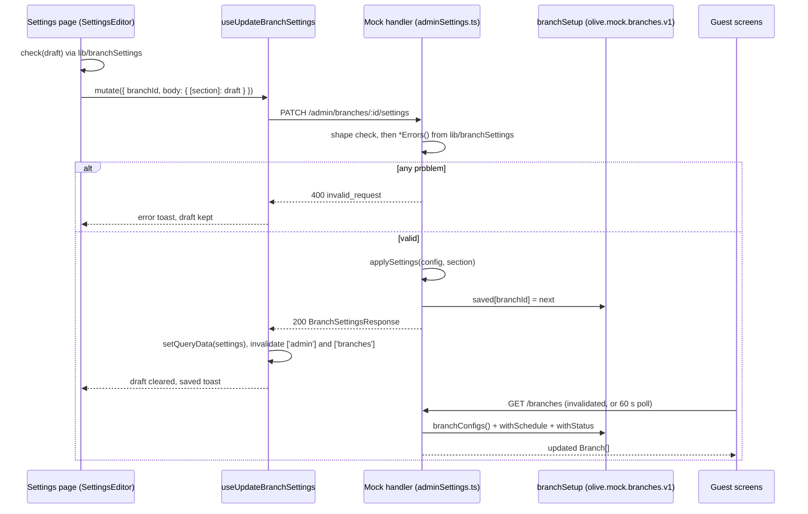

# Settings

Settings (`/admin/dashboard/settings/*`) is where staff configure the selected branch: its details
and region, hours, floor plan, taxes, payment methods, services, delivery, pickup, and the set of
branches itself. Every page edits a draft and saves one section at a time; the same validation
rules run in the page and on the server, and saved settings reach guest screens through
`GET /branches`.

## Contents

- [Page index](#page-index)
- [Frame and menu](#frame-and-menu)
- [The shared editor pattern](#the-shared-editor-pattern)
- [Validation shared by UI and server](#validation-shared-by-ui-and-server)
- [How saved settings reach guests](#how-saved-settings-reach-guests)
- [Branch details](#branch-details)
- [Opening hours](#opening-hours)
- [Floor plan](#floor-plan)
- [Tax and service charge](#tax-and-service-charge)
- [Payment methods](#payment-methods)
- [Services](#services)
- [Delivery zones](#delivery-zones)
- [Pickup](#pickup)
- [Branches](#branches)
- [Endpoint index](#endpoint-index)
- [Related](#related)

## Page index

Routes are under `/admin/dashboard/settings/`; components under
[`src/components/admin/settings/`](../src/components/admin/settings/).

| Group      | Page                 | Route         | Component                       | Saves via          |
| ---------- | -------------------- | ------------- | ------------------------------- | ------------------ |
| Branch     | Branch details       | `branch/`     | `details/BranchDetailsEditor`   | `details`          |
| Branch     | Opening hours        | `hours/`      | `hours/OpeningHoursEditor`      | `hours`            |
| Branch     | Floor plan           | `floor-plan/` | `floorPlan/FloorPlanEditor`     | `PATCH .../floors` |
| Money      | Tax & service charge | `tax/`        | `tax/TaxEditor`                 | `tax`              |
| Money      | Payment methods      | `payments/`   | `payments/PaymentMethodsEditor` | `payments`         |
| Ordering   | Services             | `services/`   | `services/ServicesEditor`       | `services`         |
| Ordering   | Delivery zones       | `delivery/`   | `delivery/DeliveryZonesEditor`  | `delivery`         |
| Ordering   | Pickup               | `pickup/`     | `pickup/PickupEditor`           | `pickup`           |
| Restaurant | Branches             | `branches/`   | `branches/BranchesManager`      | POST / DELETE      |

"Saves via" names the section of `PATCH /admin/branches/:branchId/settings` unless an endpoint is
given.

## Frame and menu

- [`src/lib/adminSettings.ts`](../src/lib/adminSettings.ts) defines `SETTINGS_GROUPS`: four groups
  (`branch`, `money`, `ordering`, `restaurant`), each with its sections (id, href, icon). Labels
  are content keys under `common › adminSettings.groups` and `adminSettings.sections`.
- `settingsHref(id)` returns a page's address; `activeSettingsSection(pathname)` returns the page
  a path is on.
- [`SettingsFrame`](../src/components/admin/settings/SettingsFrame.tsx), mounted by
  [`src/app/admin/dashboard/settings/layout.tsx`](../src/app/admin/dashboard/settings/layout.tsx),
  shows the settings menu beside the page from 1024px. On phones each page has Back to Settings
  instead, and the overview acts as the menu.
- [`SettingsHome`](../src/components/admin/settings/SettingsHome.tsx) (`/settings/`) shows every
  setting by group as a card summarising its current value.
- Adding a settings page: a route under `src/app/admin/dashboard/settings/`, an entry in
  `SETTINGS_GROUPS`, and its content keys.

## The shared editor pattern

Every page except Floor plan and Branches is built on
[`SettingsEditor`](../src/components/admin/settings/shared/SettingsEditor.tsx).

```tsx
<SettingsEditor
  section="pickup"
  title={t('adminSettings.sections.pickup.title')}
  subtitle={...}
  check={pickupErrors}
>
  {({ value, saved, set, data, errors }) => /* the form */}
</SettingsEditor>
```

How it works:

1. **Load.** `useBranchSettings(branch.id)` reads `GET /admin/branches/:branchId/settings`
   (`BranchSettingsResponse`: `settings` plus `choices`). A skeleton shows while loading, an
   error state with Try again on failure. The editor is keyed by branch id, so switching branch
   resets it.
2. **Draft.** The form edits a local draft; with no draft the saved section is shown. The page is
   dirty when the draft differs from the saved value (`sameSettings`, a JSON comparison).
3. **Check.** `check(value, data)` returns the draft's problems (`SettingsError[]`) from
   [`src/lib/branchSettings.ts`](../src/lib/branchSettings.ts). Pages use `errors` to mark
   fields.
4. **Save bar.** Once dirty, `SaveBar` appears with Discard and Save. It shows the first problem
   (`adminSettings.errors.<code>`, with `messageVars` such as the phone's `{dialCode}`), and Save
   is disabled while there is one.
5. **Save.** `useUpdateBranchSettings` sends `PATCH /admin/branches/:branchId/settings` with
   only this section (`{ [section]: value }`). On success the response replaces the cached
   settings, the draft is cleared and a toast confirms. On failure an error toast shows and the
   draft is kept.
6. **Refresh.** The mutation then invalidates every `['admin', ...]` query and `GET /branches`.

Supporting pieces:

- [`useLeaveGuard`](../src/components/admin/settings/shared/useLeaveGuard.ts): while dirty, the
  browser's own prompt on closing or reloading the tab, and a confirm on any in-app link click.
- [`NumberField`](../src/components/admin/settings/shared/NumberField.tsx): a number typed as text,
  whole (minutes, km) or decimal with up to two places (money, percentages). Empty is
  `undefined`, anything else invalid is `NaN`, so the page's checks catch it. The text is kept
  while typing (`useNumberText`), and re-formatted only when the value changes from outside, for
  example on Discard.
- [`ServiceStatus`](../src/components/admin/settings/shared/ServiceStatus.tsx): a read-only note on
  the Delivery zones and Pickup pages saying whether that service is on, linking to Services where
  it is switched.
- `SettingsCard`, `FieldGrid`, `ToggleRow` and `SettingsNote` (same file as `SettingsEditor`) give
  every page the same layout.

Floor plan uses the same draft, save bar behaviour and leave guard, but keeps its own state
because it saves through `PATCH .../floors`. Branches acts immediately, without a draft.

## Validation shared by UI and server

[`src/lib/branchSettings.ts`](../src/lib/branchSettings.ts) is pure and imported by both the pages
and the mock handler
[`src/api/mock/handlers/adminSettings.ts`](../src/api/mock/handlers/adminSettings.ts). The page
shows the first problem; the server refuses the same draft with 400 `invalid_request`. Length and
range limits are in `LIMITS`.

| Function         | Page            | Server applies it to                  |
| ---------------- | --------------- | ------------------------------------- |
| `detailsErrors`  | Branch details  | `details`, and `POST /admin/branches` |
| `hoursErrors`    | Opening hours   | `hours`                               |
| `taxErrors`      | Tax             | `tax`                                 |
| `paymentErrors`  | Payment methods | `payments`                            |
| `servicesErrors` | Services        | `services` (after applying)           |
| `deliveryErrors` | Delivery zones  | `delivery` (uses `zoneErrors`)        |
| `pickupErrors`   | Pickup          | `pickup`                              |

Key rules:

- **Details:** name, short name, city and address required, within limits. The short name must
  differ (case-insensitively) from every other branch's. The phone must be `+` and 8–15 digits and
  start with the country's dial code. Country, IANA time zone, locale and currency must be known
  values.
- **Hours:** at least one open day; valid `HH:MM` times with closing after opening; last orders
  0–180 minutes and shorter than every open day; up to 6 service windows with unique, non-empty
  labels (≤ 30 chars) and `to` after `from`.
- **Tax:** the tax lines must be exactly the branch's current lines (staff change rates, not which
  taxes exist); each rate 0–50%; a service charge, when set, 0.01–30%. Rates are basis points.
- **Payments:** every channel (`checkout`, `bill`, `takeaway`, `delivery`) has at least one
  method, all from the region's choices, without duplicates; a recommended method must be one of
  them; at-table methods likewise non-empty and known.
- **Services:** at least one of dine-in, takeaway, delivery; delivery only with at least one zone.
- **Delivery:** at least one zone when delivery is on; up to 20 zones; unique zone names; each
  zone has 1–30 areas, and an area belongs to only one zone (compared ignoring case and spacing,
  `areaKey`); fee and minimum are valid money; "free above" positive when set; time to the door
  5–240 minutes; kitchen time 0–180; maximum distance 1–100 km when set.
- **Pickup:** kitchen time 5–180 minutes; slot interval one of 10, 15, 20, 30, 45, 60
  (`SLOT_MINUTES`); minimum order valid money.

The mock handler first checks each section's shape (types only), then the rules above. Sections in
one request are applied in order (details, hours, tax, payments, delivery, pickup, services), each
checked against the branch as the previous ones left it, since a new country brings other taxes
and payment methods. Unknown or missing sections are rejected.

## How saved settings reach guests

The mock keeps what staff save in the `branchSetup` table, stored in localStorage as
`olive.mock.branches.v1` ([`src/api/mock/db.ts`](../src/api/mock/db.ts)): `saved` (full branches
by id), `added` (new branches with the branch they were copied from) and `removed`.

[`src/api/mock/seed.ts`](../src/api/mock/seed.ts) builds two views from it:

- `branchConfigs()`: `branches.json` with saved versions substituted, added branches appended and
  removed ones dropped. This is what the settings endpoints read and write (`settingsOf`,
  `applySettings`).
- `branches()`: the configs with today's hours applied (`withSchedule` from
  [`src/lib/branchHours.ts`](../src/lib/branchHours.ts)), the status staff set (`withStatus`) and
  the saved floor plan's tables. This answers `GET /branches`.

Guest screens read `GET /branches` (`branchesQuery`, refetched every 60 s and on focus), so a save
affects new carts and orders: today's hours and closed days, taxes on new bills, payment methods,
services, zones and pickup slots. Orders already placed keep their prices. The server's own order
checks read the same data, so they follow immediately.



## Branch details

Purpose: the branch's identity, what guests are told at the table, and its region.

- **Route:** `/admin/dashboard/settings/branch/`.
- **Component:** [`BranchDetailsEditor`](../src/components/admin/settings/details/BranchDetailsEditor.tsx).
- **Section:** `details` (`BranchDetails`). Check: `detailsErrors(value, otherShortNames)`.

Fields:

- Name, short name (how staff and guests tell branches apart), city, address, phone and guest
  Wi-Fi name. Where a table is comes from the floor plan: the welcome screen shows the table's
  area (`floor` from `POST /sessions`).
- A changed address gets a new maps link (`mapUrlFor`); the phone is stored without spaces.

Region (editable):

- **Country:** a select. Choosing one resets time zone, locale and currency to that country's
  defaults (`COUNTRY_DEFAULTS` in
  [`src/config/masters/regions.ts`](../src/config/masters/regions.ts)).
- **Time zone:** a text input with a `<datalist>` of suggestions (`timeZonesWith`, the country's
  default first, then every IANA zone the runtime knows). It is deliberately not a `<select>`:
  with over 400 options, Chrome opens the native dropdown over the field, so releasing the mouse
  picks whichever zone is underneath and the list appears to close immediately. Any zone `Intl`
  accepts is valid (`isTimeZone`); the hint shows the local time there.
- **Locale** and **currency:** selects from `LOCALES` and `CURRENCIES`; the locale hint shows a
  formatted example amount.
- Warnings appear when the country or currency differs from the saved value.

On save, `withRegion` applies the region. When the country changes, it also replaces the phone
rules, taxes and payment methods (checkout, bill, at table, takeaway and delivery) with that
country's preset (`REGION_PRESETS` in [`src/config/regions.ts`](../src/config/regions.ts)). Prices
keep their numbers; they are not converted.

## Opening hours

Purpose: the weekly schedule guests see and ordering follows.

- **Route:** `/admin/dashboard/settings/hours/`.
- **Component:** [`OpeningHoursEditor`](../src/components/admin/settings/hours/OpeningHoursEditor.tsx).
- **Section:** `hours` (`OpeningSchedule`, stored as `Branch.schedule`). Check: `hoursErrors`.

Rules:

- Each weekday is open (from, to) or closed.
- Last orders: minutes before closing when the kitchen takes its last order.
- Service windows (for example Lunch, Dinner): labelled time ranges guests are told about.
- Guests see today's hours, worked out by `withSchedule` in the branch's time zone. On a closed
  day the branch shows as closed, with `opensAt` and `reopensOn` naming the next opening day
  (`reopensTomorrow` when it is tomorrow). A status set from the admin bar applies on top.

## Floor plan

Purpose: the branch's areas and tables, which drive the Tables pages, QR codes and bookings.

- **Route:** `/admin/dashboard/settings/floor-plan/`.
- **Components:** [`src/components/admin/settings/floorPlan/`](../src/components/admin/settings/floorPlan/):
  `FloorPlanEditor`, `AreaDialog`, `RemoveAreaDialog`, `TableDialog`. Logic in
  [`src/lib/floorLayout.ts`](../src/lib/floorLayout.ts).
- **Endpoints:** `GET` and `PATCH /admin/branches/:branchId/floors` (`FloorPlanLayout`, the
  `floors.json` shape).

Rules:

- Areas can be added, renamed, reordered and removed (removing asks first and names its tables).
- Tables can be added (several at once, numbered from the first free number), renumbered, given
  other seats or another area, taken out of service, or removed. Numbers 1–9999, seats 1–50,
  up to 50 tables at a time.
- The whole layout is one draft, saved in one request. The server runs `layoutErrors` (400) and
  refuses removing or disabling a table with an open order or unpaid bill today, or a booking
  still to come: 409 `table_in_use` with `tables: [{ number, reason: 'openOrder' | 'booking' }]`.
  The editor lists those tables.
- Out-of-service tables stay on the plan; see
  [staff-app.md › Out-of-service tables](staff-app.md#out-of-service-tables).
- Mock: saved layouts live in the `floorLayouts` table, and `GET /branches` reflects the tables.

## Tax and service charge

Purpose: rates applied to new bills.

- **Route:** `/admin/dashboard/settings/tax/`.
- **Component:** [`TaxEditor`](../src/components/admin/settings/tax/TaxEditor.tsx).
- **Section:** `tax` (`TaxSettings`). Check: `taxErrors(value, saved tax)`.

Rules:

- One rate per tax line of the region, with what it is charged on (`items` or
  `itemsPlusService`). The lines themselves come from the region and cannot be added or removed.
- A tax split into parts (for example GST into CGST and SGST) is divided evenly by `splitRate`;
  the first part takes any odd basis point.
- An optional service charge; whether discounts come off before tax; whether to round the total
  (to the currency's minor unit, with a round-off line).
- An example bill previews the result. Orders already placed keep their taxes.

## Payment methods

Purpose: which methods guests are offered on each screen, and in what order.

- **Route:** `/admin/dashboard/settings/payments/`.
- **Component:**
  [`PaymentMethodsEditor`](../src/components/admin/settings/payments/PaymentMethodsEditor.tsx).
- **Section:** `payments` (`PaymentSettings`). Check: `paymentErrors(value, choices.payments)`.

Rules:

- Channels: dine-in checkout, Pay my bill, takeaway and delivery. Each lists methods on or off in
  display order. Checkout, takeaway and delivery can mark one method as "Fastest".
- At table: the methods printed on the bill and offered to staff when collecting in person.
- The available methods are the region's (`paymentChoicesFor(country)`, returned as
  `choices.payments`), so labels always match the country.

## Services

Purpose: which ways of ordering the branch offers.

- **Route:** `/admin/dashboard/settings/services/`.
- **Component:** [`ServicesEditor`](../src/components/admin/settings/services/ServicesEditor.tsx).
- **Section:** `services` (`{ dineIn, takeaway, delivery }`, stored as `modes.*.enabled`).
  Check: `servicesErrors(value, saved zone count)`.

Rules:

- Dine-in covers table QR codes and waiter orders at tables; takeaway and delivery are separate.
- At least one service must stay on. Delivery can be switched on only with at least one zone.
- Each service links to where it is configured (Floor plan, Pickup, Delivery zones).
- Guests see only the services that are on.

## Delivery zones

Purpose: where the branch delivers and on what terms.

- **Route:** `/admin/dashboard/settings/delivery/`.
- **Components:** [`DeliveryZonesEditor`](../src/components/admin/settings/delivery/DeliveryZonesEditor.tsx),
  `ZoneDialog`.
- **Section:** `delivery` (`DeliverySettings`). Check: `deliveryErrors`.

Rules:

- Branch-wide: kitchen time before the rider leaves (`prepMinutes`, also the kitchen board's due
  time for delivery), maximum distance, and whether the delivery fee is taxed.
- Per zone: name, areas (one per line or comma-separated, none shared with another zone), fee,
  free-above item total, minimum order, and minutes to the door.
- New zones get ids derived from their names on the server (`uniqueId`).
- Whether delivery is on is shown by `ServiceStatus` and switched in Services.

## Pickup

Purpose: how takeaway orders are scheduled.

- **Route:** `/admin/dashboard/settings/pickup/`.
- **Component:** [`PickupEditor`](../src/components/admin/settings/pickup/PickupEditor.tsx).
- **Section:** `pickup` (`PickupSettings`). Check: `pickupErrors`.

Rules:

- Kitchen time, slot interval (counted from opening), "as soon as possible" on or off, and the
  minimum order.
- A preview lists today's slots a guest ordering now would see, computed from the draft.
- Whether takeaway is on is shown by `ServiceStatus` and switched in Services.

## Branches

Purpose: manage the set of branches the admin works with.

- **Route:** `/admin/dashboard/settings/branches/`.
- **Components:** [`BranchesManager`](../src/components/admin/settings/branches/BranchesManager.tsx),
  `AddBranchDialog`.
- **Endpoints:** `POST /admin/branches` (`{ details, copyFrom }`, 201 `AdminBranch`) and
  `DELETE /admin/branches/:branchId` (204). Mutations: `useCreateBranch`, `useRemoveBranch`.

Rules:

- The list marks the branch currently selected. **Switch** selects another branch
  (`selectAdminBranch`).
- **Add** creates a copy of an existing branch with its own details. The copy takes the source's
  region, taxes, payment methods, hours, delivery and pickup, plus its menu, promotions and floor
  plan (including changes staff already made at the source). Details are validated with
  `detailsErrors`, including a unique short name. The creator manages the new branch. Ids are
  derived from city and short name and never reused, even after removal.
- **Remove** asks first. It is refused with 409 `last_branch` when it is the admin's only branch,
  and with 409 `branch_in_use` when the branch has orders today still to finish or pay. Removing
  the current branch selects another one.
- Mock: added and removed branches are recorded in `olive.mock.branches.v1`; a removed default
  branch falls back to the first remaining one for guests.

## Endpoint index

All take `Authorization: Bearer <token>`; 401 without a valid session, 403 for a branch the admin
does not manage. Shapes are in [api-contract.md](api-contract.md) and
[`src/api/contracts.ts`](../src/api/contracts.ts).

| Endpoint                                   | Purpose                              | Errors                             |
| ------------------------------------------ | ------------------------------------ | ---------------------------------- |
| `GET /admin/branches/:branchId/settings`   | Settings plus region payment choices | 401, 403                           |
| `PATCH /admin/branches/:branchId/settings` | Replace one or more sections         | 400 `invalid_request`, 401, 403    |
| `GET /admin/branches/:branchId/floors`     | Floor layout to edit                 | 401, 403                           |
| `PATCH /admin/branches/:branchId/floors`   | Replace the floor layout             | 400, 409 `table_in_use`            |
| `POST /admin/branches`                     | Add a branch as a copy               | 400, 401, 403                      |
| `DELETE /admin/branches/:branchId`         | Remove a branch                      | 409 `last_branch`, `branch_in_use` |

## Related

- [README.md](README.md)
- [architecture.md](architecture.md)
- [conventions.md](conventions.md)
- [testing.md](testing.md)
- [guest-app.md](guest-app.md)
- [staff-app.md](staff-app.md)
- [settings.md](settings.md)
- [data-and-api.md](data-and-api.md)
- [api-contract.md](api-contract.md)
- [masters-and-config.md](masters-and-config.md)
- [how-to.md](how-to.md)
- [roadmap.md](roadmap.md)
