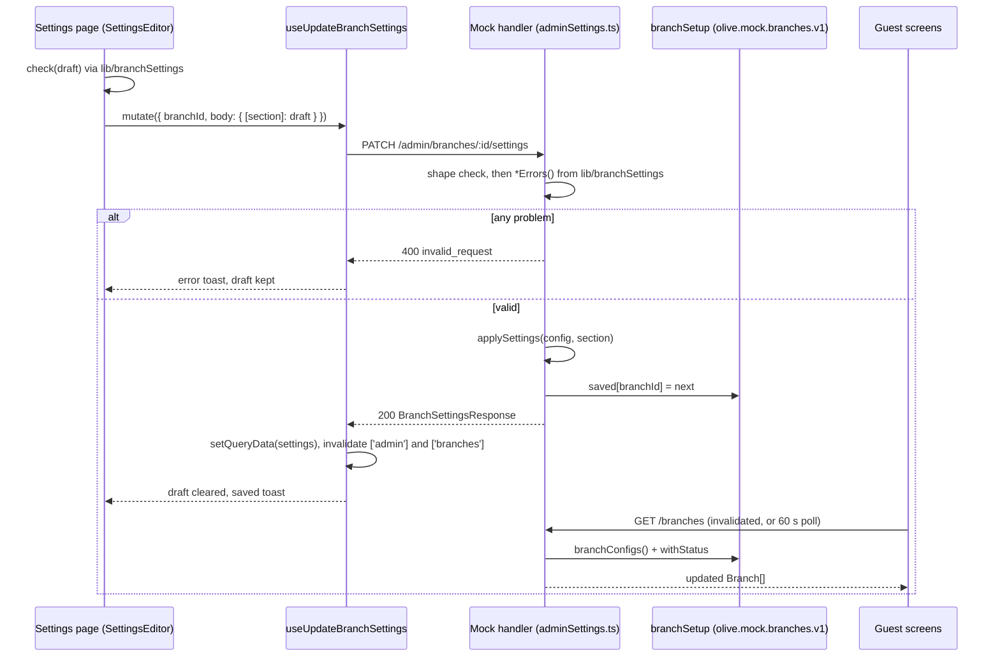

# Settings

Settings (`/admin/dashboard/settings/*`) is where staff configure the selected branch: its details
and region, the guests' Help page, hours, floor plan, taxes and invoices, payment methods,
services, delivery, pickup and offers; and for the restaurant its staff, roles, branches and
optional modules. Each page shows only to staff whose role allows it. Every branch page edits a
draft and saves one section at a time; the same validation rules run in the page and on the
server, and saved settings reach guest screens through `GET /branches`.

A few settings live on the page they belong to, not here: see
[Settings kept elsewhere](#settings-kept-elsewhere).

## Contents

- [Page index](#page-index)
- [Frame and menu](#frame-and-menu)
- [The shared editor pattern](#the-shared-editor-pattern)
- [Validation shared by UI and server](#validation-shared-by-ui-and-server)
- [How saved settings reach guests](#how-saved-settings-reach-guests)
- [Branch details](#branch-details)
- [Help page](#help-page)
- [Opening hours](#opening-hours)
- [Floor plan](#floor-plan)
- [Tax and service charge](#tax-and-service-charge)
- [Payment methods](#payment-methods)
- [Offers](#offers)
- [Services](#services)
- [Delivery zones](#delivery-zones)
- [Pickup](#pickup)
- [Staff & roles](#staff--roles)
- [Branches](#branches)
- [Modules](#modules)
- [Settings kept elsewhere](#settings-kept-elsewhere)
- [Endpoint index](#endpoint-index)
- [Related](#related)

## Page index

Routes are under `/admin/dashboard/settings/`; components under
[`src/components/admin/settings/`](../src/components/admin/settings/). The menu has three groups
of sections; a section with several pages shows them as tabs.

| Group             | Section          | Tab (page)           | Route         | Component                       | Needs                    | Saves via            |
| ----------------- | ---------------- | -------------------- | ------------- | ------------------------------- | ------------------------ | -------------------- |
| Your branch       | Restaurant info  | Details              | `branch/`     | `details/BranchDetailsEditor`   | `branch.settings.manage` | `details`            |
| Your branch       | Restaurant info  | Guest info           | `help-page/`  | `help/HelpPageEditor`           | `branch.settings.manage` | `help`               |
| Your branch       | Opening hours    | Opening hours        | `hours/`      | `hours/OpeningHoursEditor`      | `branch.settings.manage` | `hours`              |
| Your branch       | Floor plan       | Floor plan           | `floor-plan/` | `floorPlan/FloorPlanEditor`     | `tables.manage`          | `PATCH .../floors`   |
| Orders & money    | How guests order | Overview             | `services/`   | `services/ServicesEditor`       | `branch.settings.manage` | `services`           |
| Orders & money    | How guests order | Takeaway             | `pickup/`     | `pickup/PickupEditor`           | `branch.settings.manage` | `pickup`             |
| Orders & money    | How guests order | Delivery             | `delivery/`   | `delivery/DeliveryZonesEditor`  | `branch.settings.manage` | `delivery`           |
| Orders & money    | Bills & payments | Tax & service charge | `tax/`        | `tax/TaxEditor`                 | `branch.settings.manage` | `tax`                |
| Orders & money    | Bills & payments | Payment methods      | `payments/`   | `payments/PaymentMethodsEditor` | `branch.settings.manage` | `payments`           |
| Orders & money    | Offers           | Offers               | `offers/`     | `offers/OffersManager`          | `branch.settings.manage` | `.../offers`         |
| People & branches | Staff & roles    | Staff                | `staff/`      | `staff/StaffManager`            | `staff.manage`           | `.../staff`          |
| People & branches | Staff & roles    | Roles & permissions  | `roles/`      | `roles/RolesManager`            | `staff.manage`           | `.../roles`          |
| People & branches | Branches         | Branches             | `branches/`   | `branches/BranchesManager`      | `branches.manage`        | POST / DELETE        |
| People & branches | Branches         | Modules              | `modules/`    | `ModulesSettings`               | super admins only        | `PATCH .../features` |

"Saves via" names the section of `PATCH /admin/branches/:branchId/settings` unless an endpoint is
given. The old `rota/` and `shifts/` addresses point to Shifts & attendance (see
[staff-app.md › Shifts & attendance](staff-app.md#shifts--attendance)).

## Frame and menu

- [`src/lib/adminSettings.ts`](../src/lib/adminSettings.ts) defines `SETTINGS_GROUPS`: three
  groups (`branch`, `money`, `restaurant`), each with its sections (`topics`: `info`, `hours`,
  `tables`, `ordering`, `billing`, `offers`, `team`, `branches`), each with its pages in tab
  order. A page names the permission its server routes check (`needs`); `platformOnly` marks
  Modules. Labels are content keys under `common › adminSettings.groups`, `.topics`, `.tabs` and
  `.sections`.
- `settingsFor(can, platform)` returns only the groups, sections and pages a staff member may
  open; a section opens on its first page they may open. `canOpenPage` checks one page.
- `settingsHref(id)` returns a page's address; `activeSettingsSection(pathname)` returns the page
  a path is on.
- [`SettingsFrame`](../src/components/admin/settings/SettingsFrame.tsx), mounted by
  [`src/app/admin/dashboard/settings/layout.tsx`](../src/app/admin/dashboard/settings/layout.tsx),
  shows the settings menu beside the page from 1024px, and the section's tabs above the page. On
  phones each page has Back to Settings instead, and the overview acts as the menu. A page the
  staff member may not open shows `NoAccess`.
- [`SettingsHome`](../src/components/admin/settings/SettingsHome.tsx) (`/settings/`) shows every
  section they may open by group, as a card summarising its current value.
- Adding a settings page: a route under `src/app/admin/dashboard/settings/`, an entry in its
  section in `SETTINGS_GROUPS`, and its content keys.

## The shared editor pattern

Every branch page except Floor plan and Offers is built on
[`SettingsEditor`](../src/components/admin/settings/shared/SettingsEditor.tsx).

```tsx
<SettingsEditor
  section="pickup"
  title={t('adminSettings.sections.pickup.title')}
  subtitle={...}
  check={pickupErrors}
>
  {({ value, saved, set, data, errors }) => /* the form */}
</SettingsEditor>
```

How it works:

1. **Load.** `useBranchSettings(branch.id)` reads `GET /admin/branches/:branchId/settings`
   (`BranchSettingsResponse`: `settings` plus `choices`). A skeleton shows while loading, an
   error state with Try again on failure. The editor is keyed by branch id, so switching branch
   resets it.
2. **Draft.** The form edits a local draft; with no draft the saved section is shown. The page is
   dirty when the draft differs from the saved value (`sameSettings`, a JSON comparison).
3. **Check.** `check(value, data)` returns the draft's problems (`SettingsError[]`) from
   [`src/lib/branchSettings.ts`](../src/lib/branchSettings.ts). Pages use `errors` to mark
   fields.
4. **Save bar.** Once dirty, `SaveBar` appears with Discard and Save. It shows the first problem
   (`adminSettings.errors.<code>`, with `messageVars` such as the phone's `{dialCode}`), and Save
   is disabled while there is one.
5. **Save.** `useUpdateBranchSettings` sends `PATCH /admin/branches/:branchId/settings` with
   only this section (`{ [section]: value }`). On success the response replaces the cached
   settings, the draft is cleared and a toast confirms. On failure an error toast shows and the
   draft is kept.
6. **Refresh.** The mutation then invalidates every `['admin', ...]` query and `GET /branches`.

Supporting pieces:

- [`useLeaveGuard`](../src/components/admin/settings/shared/useLeaveGuard.ts): while dirty, the
  browser's own prompt on closing or reloading the tab, and a confirm on any in-app link click.
- [`NumberField`](../src/components/admin/settings/shared/NumberField.tsx): a number typed as text,
  whole (minutes, km) or decimal with up to two places (money, percentages). Empty is
  `undefined`, anything else invalid is `NaN`, so the page's checks catch it. The text is kept
  while typing (`useNumberText`), and re-formatted only when the value changes from outside, for
  example on Discard.
- [`ServiceStatus`](../src/components/admin/settings/shared/ServiceStatus.tsx): a read-only note on
  the Delivery zones and Pickup pages saying whether that service is on, linking to Services where
  it is switched.
- `SettingsCard`, `FieldGrid`, `ToggleRow` and `SettingsNote` (same file as `SettingsEditor`) give
  every page the same layout.

Floor plan uses the same draft, save bar behaviour and leave guard, but keeps its own state
because it saves through `PATCH .../floors`. Offers, Staff, Roles, Branches and Modules act
immediately through their own endpoints, without a draft.

## Validation shared by UI and server

[`src/lib/branchSettings.ts`](../src/lib/branchSettings.ts) (a barrel over
[`src/lib/branchSettings/`](../src/lib/branchSettings/): `checking.ts`, `help-page.ts`,
`reading.ts`, `writing.ts`, `shared.ts`) is pure and imported by both the pages
and the mock handler
[`src/api/mock/handlers/adminSettings.ts`](../src/api/mock/handlers/adminSettings.ts). The page
shows the first problem; the server refuses the same draft with 400 `invalid_request`. Length and
range limits are in `LIMITS`.

| Function         | Page            | Server applies it to                  |
| ---------------- | --------------- | ------------------------------------- |
| `detailsErrors`  | Branch details  | `details`, and `POST /admin/branches` |
| `helpErrors`     | Help page       | `help`                                |
| `hoursErrors`    | Opening hours   | `hours`                               |
| `taxErrors`      | Tax             | `tax`                                 |
| `paymentErrors`  | Payment methods | `payments`                            |
| `servicesErrors` | Services        | `services` (after applying)           |
| `deliveryErrors` | Delivery zones  | `delivery` (uses `zoneErrors`)        |
| `pickupErrors`   | Pickup          | `pickup`                              |

Key rules:

- **Details:** name, short name, city and address required, within limits. The short name must
  differ (case-insensitively) from every other branch's. The phone must be `+` and 8–15 digits and
  start with the country's dial code. Country, IANA time zone, locale and currency must be known
  values. The order prefix, when sent, is 1 to 5 capital letters; the start number a whole number
  from 1 to 999999 (`LIMITS.orderStart`).
- **Help page:** Wi-Fi name ≤ 40 characters, password ≤ 63; each social link an `https` address
  on that network's own site (`isSocialUrl`; "https://" is added when left off); up to 20
  questions, each with a question (≤ 120) and an answer (≤ 1000). An empty pair is dropped.
- **Hours:** at least one open day; up to 4 sessions a day (`LIMITS.sessionsPerDay`) with names
  ≤ 30 characters, valid times ("next day" past midnight, or all day) and no overlaps, also for
  takeaway's and delivery's own weeks; last orders 0–180 minutes and shorter than every session;
  up to 50 special dates, each a range of under 62 days, named ≤ 40 characters, not overlapping.
- **Tax:** the tax lines must be exactly the branch's current lines (staff change rates, not which
  taxes exist); each rate 0–50%; a service charge, when set, 0.01–30%. Rates are basis points.
  A registration number, when given, must fit the country's form (`taxIdOf`): a GSTIN in India
  (`29ABCDE1234F1Z5`), a nine-digit PAN in Nepal, elsewhere 5–20 letters, digits and dashes.
  It is stored in capitals without spaces (`cleanTaxId`). The registered business name is at most
  120 characters; the invoice prefix, when set, 1 to 5 capital letters.
- **Payments:** every channel (`checkout`, `bill`, `takeaway`, `delivery`) has at least one
  method, all from the region's choices, without duplicates; a recommended method must be one of
  them; at-table methods likewise non-empty and known.
- **Services:** at least one of dine-in, takeaway, delivery; delivery only with at least one zone.
- **Delivery:** at least one zone when delivery is on; up to 20 zones; unique zone names; each
  zone has 1–30 areas, and an area belongs to only one zone (compared ignoring case and spacing,
  `areaKey`); fee and minimum are valid money; "free above" positive when set; time to the door
  5–240 minutes; kitchen time 0–180; maximum distance 1–100 km when set.
- **Pickup:** kitchen time 5–180 minutes; slot interval one of 10, 15, 20, 30, 45, 60
  (`SLOT_MINUTES`); minimum order valid money.

The mock handler first checks each section's shape (types only), then the rules above. Sections in
one request are applied in order (details, help, hours, tax, payments, delivery, pickup,
services), each
checked against the branch as the previous ones left it, since a new country brings other taxes
and payment methods. Unknown or missing sections are rejected.

## How saved settings reach guests

The mock keeps what staff save in the `branchSetup` table, stored in localStorage as
`olive.mock.branches.v1` ([`src/api/mock/db.ts`](../src/api/mock/db.ts)): `saved` (full branches
by id), `added` (new branches with the branch they were copied from) and `removed`.

[`src/api/mock/seed.ts`](../src/api/mock/seed.ts) builds two views from it:

- `branchConfigs()`: `branches.json` with saved versions substituted, added branches appended and
  removed ones dropped. This is what the settings endpoints read and write (`settingsOf`,
  `applySettings`).
- `branches()`: the configs with their status now (`withStatus` in
  [`src/api/mock/branchStatus.ts`](../src/api/mock/branchStatus.ts): what staff set while it
  lasts, else the hours by `scheduleStatus` from
  [`src/lib/branchHours.ts`](../src/lib/branchHours.ts), each with `statusUntil`, and
  `modeStatus` for takeaway and delivery). This answers `GET /branches`.

Guest screens read `GET /branches` and their branch's `GET /branches/:id/config`
(`branchesQuery`, `branchConfigQuery`: again after 10 minutes and on focus), so a save
affects new carts and orders: today's hours and closed days, taxes on new bills, payment methods,
services, zones and pickup slots. Orders already placed keep their prices. The server's own order
checks read the same data, so they follow immediately.



## Branch details

Purpose: the branch's identity, what guests are told at the table, and its region.

- **Route:** `/admin/dashboard/settings/branch/` (Restaurant info › Details).
- **Components:** [`BranchDetailsEditor`](../src/components/admin/settings/details/BranchDetailsEditor.tsx),
  `BranchPhotoField`.
- **Section:** `details` (`BranchDetails`). Check: `detailsErrors(value, otherShortNames)`.

Fields:

- Name, short name (how staff and guests tell branches apart), city, address and phone. Where a
  table is comes from the floor plan: the welcome screen shows the table's area (`floor` from
  `POST /sessions`).
- **Restaurant image:** JPEG, PNG or WebP, resized in the browser, then uploaded
  (`POST /admin/branches/:branchId/settings/image`). It shows on the staff branch picker; without
  one, the short name's first letter.
- The guest Wi-Fi, social links and FAQs moved to the [Help page](#help-page); this page links
  there.
- A changed address gets a new maps link (`mapUrlFor`); the phone is stored without spaces.
- **Order numbers** (shown once the server sends `orderPrefix` and `orderStart`): the prefix
  (1 to 5 capital letters, typed in any case) and the number new orders count up from, with an
  example (`orderCodeOf`: `UDY` and 1 give `UDY-001`). A new prefix starts at the start number
  again; numbers already used are never given again. Each order also gets a daily token (from 1
  every day), which staff screens and the guest's confirmation and tracking show.

Region (editable):

- **Country:** a select. Choosing one resets time zone, locale and currency to that country's
  defaults (`COUNTRY_DEFAULTS` in
  [`src/config/masters/regions.ts`](../src/config/masters/regions.ts)).
- **Time zone:** a text input with a `<datalist>` of suggestions (`timeZonesWith`, the country's
  default first, then every IANA zone the runtime knows). It is deliberately not a `<select>`:
  with over 400 options, Chrome opens the native dropdown over the field, so releasing the mouse
  picks whichever zone is underneath and the list appears to close immediately. Any zone `Intl`
  accepts is valid (`isTimeZone`); the hint shows the local time there.
- **Locale** and **currency:** selects from `LOCALES` and `CURRENCIES`; the locale hint shows a
  formatted example amount.
- Warnings appear when the country or currency differs from the saved value.

On save, `withRegion` applies the region. When the country changes, it also replaces the phone
rules, taxes and payment methods (checkout, bill, at table, takeaway and delivery) with that
country's preset (`REGION_PRESETS` in [`src/config/regions.ts`](../src/config/regions.ts)). Prices
keep their numbers; they are not converted.

## Help page

Purpose: what guests see on the Help page. Anything left empty isn't shown to them.

- **Route:** `/admin/dashboard/settings/help-page/` (Restaurant info › Guest info).
- **Component:** [`HelpPageEditor`](../src/components/admin/settings/help/HelpPageEditor.tsx).
- **Section:** `help` (`HelpSettings`). Check: `helpErrors`; limits in `HELP_LIMITS`
  ([`src/lib/branchSettings/help-page.ts`](../src/lib/branchSettings/help-page.ts)).

Three cards, in the order guests see them:

- **Guest Wi-Fi:** network name and optional password. Only guests seated at a table see them,
  with a button to copy the password and a QR code to join.
- **Social media:** one link per network: Instagram, Facebook, YouTube, TikTok, X (Twitter),
  WhatsApp and Google reviews (`SOCIAL_NETWORKS`). Shared by all the restaurant's branches; an
  empty one hides its icon. Check link opens a link in a new tab.
- **Questions and answers:** up to 20, reordered with Move up / Move down, shown under
  "Allergens & FAQs". Opening hours and the address are added for guests from the branch's
  settings.

## Opening hours

Purpose: the weekly schedule guests see and ordering follows.

- **Route:** `/admin/dashboard/settings/hours/`.
- **Components:** [`OpeningHoursEditor`](../src/components/admin/settings/hours/OpeningHoursEditor.tsx),
  `SessionsEditor`.
- **Section:** `hours` (`OpeningSchedule`, stored as `Branch.schedule`). Check: `hoursErrors`.

Rules:

- Each weekday has up to 4 sessions (lunch, dinner…), each with an optional name, opening and
  closing time; one may run past midnight ("next day") or all day. A day without any is closed.
- Last orders: minutes before each session closes when the kitchen takes its last order.
- Takeaway and delivery can have their own weeks, or follow the opening hours.
- Special dates (holidays, festivals): a day or a range with its own sessions, or closed. They
  replace the week for every way of ordering.
- Guests can order inside a session until its last orders; otherwise the branch shows as closed
  until the next one.
- The server sends each way of ordering's status and `statusUntil` (the next change); guest
  screens word it on the device (`branchTimes` in
  [`src/lib/branchHours.ts`](../src/lib/branchHours.ts), `useBranchTimes`) in the branch's time
  zone: open until last orders, or closed until the next session. A status set from the admin
  bar applies on top while it lasts.

## Floor plan

Purpose: the branch's areas and tables, which drive the Tables pages, QR codes and bookings.

- **Route:** `/admin/dashboard/settings/floor-plan/` (needs `tables.manage`).
- **Components:** [`src/components/admin/settings/floorPlan/`](../src/components/admin/settings/floorPlan/):
  `FloorPlanEditor`, `AreaDialog`, `TableDialog`. Logic in
  [`src/lib/floorLayout.ts`](../src/lib/floorLayout.ts).
- **Endpoints:** `GET` and `PATCH /admin/branches/:branchId/floors` (`FloorPlanLayout`, the
  `floors.json` shape).

Rules:

- Areas can be added, renamed, reordered and removed (removing asks first and names its tables).
- Tables can be added (several at once, numbered from the first free number), renumbered, given
  other seats or another area, taken out of service, or removed. Numbers 1–9999, seats 1–50,
  up to 50 tables at a time.
- The whole layout is one draft, saved in one request. The server runs `layoutErrors` (400) and
  refuses removing or disabling a table with an open order or unpaid bill today, or a booking
  still to come: 409 `table_in_use` with `tables: [{ number, reason: 'openOrder' | 'booking' }]`.
  The editor lists those tables.
- Out-of-service tables stay on the plan; see
  [staff-app.md › Out-of-service tables](staff-app.md#out-of-service-tables).
- Mock: saved layouts live in the `floorLayouts` table, and `GET /branches` reflects the tables.

## Tax and service charge

Purpose: rates applied to new bills.

- **Route:** `/admin/dashboard/settings/tax/` (Bills & payments › Tax & service charge).
- **Component:** [`TaxEditor`](../src/components/admin/settings/tax/TaxEditor.tsx).
- **Section:** `tax` (`TaxSettings`). Check: `taxErrors(value, saved tax, country)`.

There is no separate company-details page: the business's tax identity lives here.

Rules:

- **Charge GST / Charge VAT** (`enabled`; the switch is named after the region's tax): on means
  the branch is registered for it. Off, new bills have no tax lines (the rates are kept for
  switching back on and the rates card is hidden), and the bill is called "Bill of supply" in
  India or "Bill" elsewhere (Nepal) instead of "GST invoice" / "VAT invoice". Orders billed that
  way carry `taxCharged: false`.
- **Registration number** (`taxId`, optional): GSTIN in India, "PAN / VAT number" in Nepal,
  printed on bills. Its label and hint follow the country (`taxIdKey`).
- **Tax invoices** card (shown when the server sends these fields; the mock has none): printed on
  every invoice, and invoices already issued keep what they had.
  - **Registered business name** (`legalName`): as on the tax registration; empty uses the
    branch name.
  - **Invoice number prefix** (`invoicePrefix`): 1 to 5 capital letters, for example `OLV` for
    `OLV/26-27/000001`; empty uses the order prefix. New invoices only.
  - India only: **SAC code** (`sacCode`; empty uses 996331, restaurant service) and **FSSAI
    licence number** (`fssai`, 14 digits).
- Invoices are numbered per financial year (Nepal's year runs Shrawan–Asar). The year is worked
  out by the server, not set here.
- `taxWording(country, tax)` in [`src/lib/branchSettings.ts`](../src/lib/branchSettings.ts)
  works out the bill's title (`invoiceKey`, words in `service › region.taxInvoice`) and its
  one-line summary label (`compactLabelKey`); `withTax` applies the section to the branch.
- One rate per tax line of the region, with what it is charged on (`items` or
  `itemsPlusService`). The lines themselves come from the region and cannot be added or removed.
- A tax split into parts (for example GST into CGST and SGST) is divided evenly by `splitRate`;
  the first part takes any odd basis point.
- An optional service charge; whether discounts come off before tax; whether to round the total
  (to the currency's minor unit, with a round-off line).
- An example bill previews the result. Orders already placed keep their taxes.

## Payment methods

Purpose: which methods guests are offered on each screen, and in what order.

- **Route:** `/admin/dashboard/settings/payments/`.
- **Component:**
  [`PaymentMethodsEditor`](../src/components/admin/settings/payments/PaymentMethodsEditor.tsx).
- **Section:** `payments` (`PaymentSettings`). Check: `paymentErrors(value, choices.payments)`.

Rules:

- Channels: dine-in checkout, Pay my bill, takeaway and delivery. Each lists methods on or off in
  display order. Checkout, takeaway and delivery can mark one method as "Fastest".
- At table: the methods printed on the bill and offered to staff when collecting in person.
- The available methods are the region's (`paymentChoicesFor(country)`, returned as
  `choices.payments`), so labels always match the country.

## Offers

Purpose: automatic discounts guests get without a code, such as happy hour.

- **Route:** `/admin/dashboard/settings/offers/`.
- **Components:** [`OffersManager`](../src/components/admin/settings/offers/OffersManager.tsx)
  (the list) and `OfferDialog` (add and edit). Logic in
  [`src/lib/adminOffers.ts`](../src/lib/adminOffers.ts): the form (`draftOf`, `offerErrors`,
  `offerRequest`) and where an offer stands now (`offerStanding`: On now, Active, Starts …,
  Ended …, Paused).
- **Endpoints:** `GET`, `POST /admin/branches/:branchId/offers`, `PATCH` and `DELETE …/offers/:offerId`
  (`OfferRequest` in `src/api/contracts.ts`). The mock only lists the seed's offers; saving needs
  the backend.

Each offer has a name (shown to guests on the menu badge, banner and bill), switched on or paused,
its days, a from–until time (branch time; ending before it starts runs past midnight), optional
first and last day, the ways of ordering it applies to, what it covers (whole categories and/or
single dishes) and the discount: a percentage off, an amount off each item, or a fixed price
each. Each card has Pause / Switch on, Edit and Remove. Saving refreshes the guest promotions, so
menu prices follow at once; orders keep the offer's name as it was.

## Services

Purpose: which ways of ordering the branch offers.

- **Route:** `/admin/dashboard/settings/services/`.
- **Component:** [`ServicesEditor`](../src/components/admin/settings/services/ServicesEditor.tsx).
- **Section:** `services` (`{ dineIn, takeaway, delivery }`, stored as `modes.*.enabled`).
  Check: `servicesErrors(value, saved zone count)`.

Rules:

- Dine-in covers table QR codes and waiter orders at tables; takeaway and delivery are separate.
- At least one service must stay on. Delivery can be switched on only with at least one zone.
- Each service links to where it is configured (Floor plan, Pickup, Delivery zones).
- Guests see only the services that are on.

## Delivery zones

Purpose: where the branch delivers and on what terms.

- **Route:** `/admin/dashboard/settings/delivery/`.
- **Components:** [`DeliveryZonesEditor`](../src/components/admin/settings/delivery/DeliveryZonesEditor.tsx),
  `ZoneDialog`.
- **Section:** `delivery` (`DeliverySettings`). Check: `deliveryErrors`.

Rules:

- Branch-wide: kitchen time before the rider leaves (`prepMinutes`, also the kitchen board's due
  time for delivery), maximum distance, and whether the delivery fee is taxed.
- Per zone: name, areas (one per line or comma-separated, none shared with another zone), fee,
  free-above item total, minimum order, and minutes to the door.
- New zones get ids derived from their names on the server (`uniqueId`).
- Whether delivery is on is shown by `ServiceStatus` and switched in Services.

## Pickup

Purpose: how takeaway orders are scheduled.

- **Route:** `/admin/dashboard/settings/pickup/`.
- **Component:** [`PickupEditor`](../src/components/admin/settings/pickup/PickupEditor.tsx).
- **Section:** `pickup` (`PickupSettings`). Check: `pickupErrors`.

Rules:

- Kitchen time, slot interval (counted from opening), "as soon as possible" on or off, and the
  minimum order.
- A preview lists today's slots a guest ordering now would see, computed from the draft.
- Whether takeaway is on is shown by `ServiceStatus` and switched in Services.

## Staff & roles

Purpose: who works at the branch, and what each role lets them do. Both pages need
`staff.manage`. Backend only.

### Staff

- **Route:** `/admin/dashboard/settings/staff/`.
- **Components:** [`StaffManager`](../src/components/admin/settings/staff/StaffManager.tsx),
  `StaffDialogs`.
- **Endpoints:** `GET`, `POST /admin/branches/:branchId/staff`; `PATCH …/staff/:id`;
  `POST …/staff/:id/password`, `…/remove`, `…/restore`.

Rules:

- Everyone who works at the branch, and the restaurant's admins: their role (this branch or all
  branches), how to reach them, whether they can sign in and when they last did. Filter Active,
  Inactive, Removed.
- **Add staff:** name, email, mobile number, role and a temporary password (or a generated one).
  They choose their own the first time they sign in.
- **Edit**, **New password**, **Turn off sign-in** / **Turn on sign-in** and **Remove from team**,
  each off or remove with a reason. Turning sign-in off signs them out, frees their tables and
  closes an open shift. Removing keeps their name on past orders, payments and shifts; Removed
  lists them to **Add back**.
- Changing someone's email or mobile number signs them out.
- The server keeps the rules: nobody changes their own role or status or removes themselves, the
  restaurant keeps at least one active admin, and staff can only give roles whose permissions
  they hold themselves.

### Roles & permissions

- **Route:** `/admin/dashboard/settings/roles/`.
- **Components:** [`RolesManager`](../src/components/admin/settings/roles/RolesManager.tsx),
  `RoleDialog`. Logic in [`src/lib/adminRoles.ts`](../src/lib/adminRoles.ts).
- **Endpoints:** `GET`, `POST /admin/branches/:branchId/roles`; `PATCH`, `DELETE …/roles/:id`.

Rules:

- Built-in roles are read-only: View or Duplicate. The restaurant's own roles are added, changed
  and deleted here; each card shows how many staff hold it and how many permissions it has.
- A role has a name, what it's for, and its permissions in plain groups (Serving guests, Kitchen,
  Orders, bookings & reports, Menu & tables, Branch, Staff, Inventory, Purchasing). Each says
  which pages it opens. Switching one on switches on what it needs; those stay on, locked.
- **Discount limit (%):** the most this role's staff can take off a bill by hand, up to the
  editor's own limit.
- Groups of a module that's off (inventory and purchasing) are hidden.
- A role still held by staff can't be deleted; nobody can give permissions they don't have.

## Branches

Purpose: manage the set of branches the admin works with.

- **Route:** `/admin/dashboard/settings/branches/`.
- **Components:** [`BranchesManager`](../src/components/admin/settings/branches/BranchesManager.tsx),
  `AddBranchDialog`.
- **Endpoints:** `POST /admin/branches` (`{ details, copyFrom }`, 201 `AdminBranch`) and
  `DELETE /admin/branches/:branchId` (204). Mutations: `useCreateBranch`, `useRemoveBranch`.

Rules:

- The list marks the branch currently selected. **Switch** selects another branch
  (`selectAdminBranch`).
- **Add** creates a copy of an existing branch with its own details. The copy takes the source's
  region, taxes, payment methods, hours, delivery and pickup, plus its menu, promotions and floor
  plan (including changes staff already made at the source). Details are validated with
  `detailsErrors`, including a unique short name. The creator manages the new branch. Ids are
  derived from city and short name and never reused, even after removal.
- **Remove** asks first. It is refused with 409 `last_branch` when it is the admin's only branch,
  and with 409 `branch_in_use` when the branch has orders today still to finish or pay. Removing
  the current branch selects another one.
- Mock: added and removed branches are recorded in `olive.mock.branches.v1`; a removed default
  branch falls back to the first remaining one for guests.

## Modules

Purpose: switch optional parts of the app on or off for the whole restaurant.

- **Route:** `/admin/dashboard/settings/modules/` (super admins only: the platform team).
- **Component:** [`ModulesSettings`](../src/components/admin/settings/ModulesSettings.tsx).
- **Endpoints:** `GET`, `PATCH /admin/branches/:branchId/features`.

Rules:

- One module today: **Inventory and purchasing**, on or off for every branch.
- Off, the restaurant works without stock as before: the server drops every `inventory.*` and
  `purchase.*` permission, so those pages, buttons and role groups disappear. Its data is kept,
  and dishes stock had taken off the menu come back.
- Switched on again, the Stock tab asks staff to count stock first.

## Settings kept elsewhere

Some settings sit on the page they belong to, for the staff who use it:

| Setting                                                  | Where                                  | Needs                 |
| -------------------------------------------------------- | -------------------------------------- | --------------------- |
| Cash difference allowed at close                         | Cash register › Reports                | `cash.review`         |
| Purchase approval (off by default) and price-rise alerts | Purchasing › Settings (page head)      | `purchase.approve`    |
| No-show grace, deposits and refund window                | Reservations › Booking rules           | `reservations.manage` |
| Discount limit per role                                  | Settings › Staff & roles › Roles       | `staff.manage`        |
| Kitchen screen (sound, text size, station, auto-print)   | Kitchen › Screen settings (per device) | `kitchen.update`      |
| Shift types and the rota                                 | Shifts & attendance › Rota             | `rota.plan`           |

Fiscal years (This FY and Last FY in reports and the sales register) are not a setting: the
server works them out from the branch's country (India April–March; Nepal Shrawan–Asar, from
Bikram Sambat).

## Endpoint index

All take `Authorization: Bearer <token>`; 401 without a valid session, 403 for a branch the admin
does not manage. Shapes are in [api-contract.md](api-contract.md) and
[`src/api/contracts.ts`](../src/api/contracts.ts).

| Endpoint                                                        | Purpose                              | Errors                             |
| --------------------------------------------------------------- | ------------------------------------ | ---------------------------------- |
| `GET /admin/branches/:branchId/settings`                        | Settings plus region payment choices | 401, 403                           |
| `PATCH /admin/branches/:branchId/settings`                      | Replace one or more sections         | 400 `invalid_request`, 401, 403    |
| `GET /admin/branches/:branchId/floors`                          | Floor layout to edit                 | 401, 403                           |
| `PATCH /admin/branches/:branchId/floors`                        | Replace the floor layout             | 400, 409 `table_in_use`            |
| `POST /admin/branches`                                          | Add a branch as a copy               | 400, 401, 403                      |
| `DELETE /admin/branches/:branchId`                              | Remove a branch                      | 409 `last_branch`, `branch_in_use` |
| `GET /admin/branches/:branchId/offers`                          | Every automatic offer (paused too)   | 401, 403                           |
| `POST /admin/branches/:branchId/offers`                         | Add an offer                         | 400, 422 `offer_scope_unknown`     |
| `PATCH …/offers/:offerId`                                       | Replace an offer                     | 400, 404, 422                      |
| `DELETE …/offers/:offerId`                                      | Remove an offer                      | 404                                |
| `POST /admin/branches/:branchId/settings/image`                 | Upload the restaurant image          | 400                                |
| `GET`, `POST /admin/branches/:branchId/staff`                   | Staff list, add staff                | 400, 403                           |
| `PATCH …/staff/:id`; `POST …/password`, `…/remove`, `…/restore` | Change a staff member                | 400, 403, 409                      |
| `GET`, `POST /admin/branches/:branchId/roles`                   | Roles, add a role                    | 400, 403                           |
| `PATCH`, `DELETE …/roles/:id`                                   | Change or delete a role              | 403, 409                           |
| `GET`, `PATCH /admin/branches/:branchId/features`               | Optional modules (super admin)       | 403                                |

## Related

- [README.md](README.md)
- [architecture.md](architecture.md)
- [conventions.md](conventions.md)
- [testing.md](testing.md)
- [guest-app.md](guest-app.md)
- [staff-app.md](staff-app.md)
- [settings.md](settings.md)
- [data-and-api.md](data-and-api.md)
- [api-contract.md](api-contract.md)
- [masters-and-config.md](masters-and-config.md)
- [how-to.md](how-to.md)
- [roadmap.md](roadmap.md)
